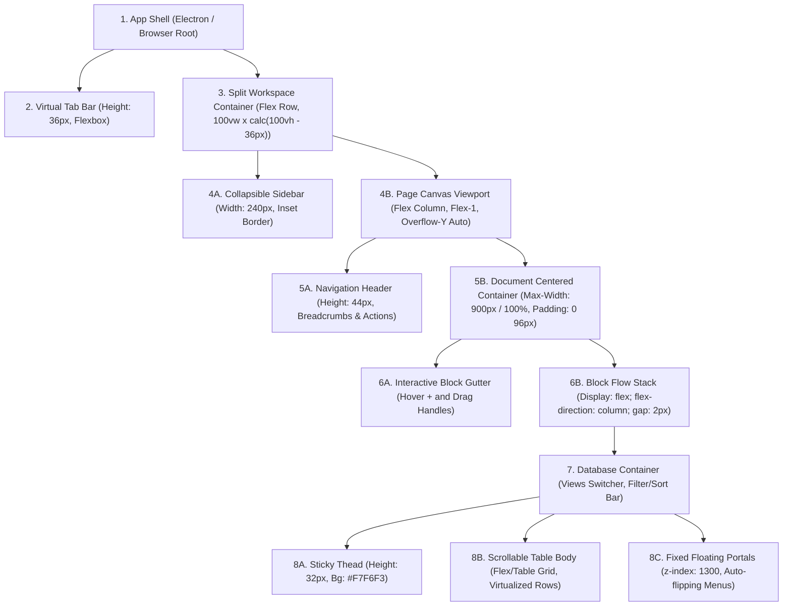

# Laporan Analisis REA: Rekayasa Balik Antarmuka Notion App & Cetak Biru UI (`plan-ui.md`)

Dokumen ini disusun menggunakan metodologi **REA (Reverse Engineering Agent)** dengan melakukan inspeksi langsung pada biner dan bundle artefak aplikasi **Notion Desktop macOS** (`/Applications/Notion.app`). Analisis ini mengekstrak struktur hierarki komponen, sistem tata letak (flexbox/grid), atribut visual (warna kanonikal, tipografi, ukuran, border, shadow), serta status interaksi (hover, click, transition, collision popover, dan skeleton) untuk menjadi standar implementasi antarmuka pada aplikasi **Noted**.

---

## 1. Metadata Target & Bukti Ekstraksi REA

| Parameter | Nilai Bukti Ekstraksi |
| :--- | :--- |
| **Aplikasi Target** | `/Applications/Notion.app` (macOS Darwin arm64/x64) |
| **Versi Rilis** | `7.39.0` (Production Channel) |
| **Framework Runtime** | Electron `44.4.4` + Node.js + React `18.2.0` |
| **Bundler & Arsitektur** | Webpack 5 (`.webpack/main/index.js`, `.webpack/renderer/tabs/index.js`) |
| **Pustaka Inti Diekstrak** | `@notionhq/shared-styles`, `@atlaskit/pragmatic-drag-and-drop`, `colord` |
| **Lokasi Unpacked ASAR** | `app.asar` -> `.webpack/` & `node_modules/@notionhq/` |

---

## 2. Struktur Hierarki Komponen & Sistem Tata Letak

### 2.1 Multi-Window & Shell Architecture (Electron Layer)
Bukti diekstrak dari `.webpack/main/index.js` (Modul 60522 & 65703):
```javascript
// Bukti konfigurasi window Notion Desktop
titleBarStyle: "hiddenInset",
autoHideMenuBar: true,
minWidth: 640,
minHeight: 480,
defaultWidth: 1200,
defaultHeight: 860,
// Perhitungan offset Traffic Light macOS (Close/Minimize/Fullscreen)
tabBarHeight: 36, // TAB_BAR_HEIGHT_PX = 36px
controlSize: 12,  // Ukuran tombol traffic light macOS standar
trafficLightPosition: {
  x: 12,
  y: Math.max(0, Math.round((36 - 12) / 2)) // y: 12px (vertically centered)
}
```

### 2.2 Hierarki Komponen Pohon UI (DOM & React Tree)
Notion menyusun antarmuka menggunakan struktur hierarkis berikut:



### 2.3 Rincian Tata Letak Flexbox & Grid

#### A. Tab Bar Desktop
- **Display**: `flex; flex-direction: row; align-items: center;`
- **Tinggi**: `36px` (`TAB_BAR_HEIGHT_PX = 36`).
- **Padding**: `0 12px 0 80px` (memberi ruang 80px untuk traffic lights macOS).
- **Tab Item**: `display: flex; align-items: center; gap: 6px; padding: 4px 8px; border-radius: 6px; height: 28px; font-size: 13px; font-weight: 500;`.
- **Tab Aktif**: Background putih (`rgba(255, 255, 255, 1)`), bayangan lembut `0 1px 2px rgba(15, 15, 15, 0.1)`, teks utama kontras tinggi.

#### B. Sidebar Navigasi
- **Display**: `flex; flex-direction: column;`
- **Lebar**: Default `240px`, batas resizable `200px` hingga `480px`.
- **Latar Belakang**: `rgba(249, 248, 247, 1)` (Light) / `rgba(32, 32, 32, 1)` (Dark).
- **Pemisah / Border**: `box-shadow: inset -1px 0px 0px 0px rgba(55, 53, 47, 0.09)`.
- **Item Baris Navigasi**: `height: 30px; padding: 2px 8px; margin: 1px 4px; border-radius: 4px; display: flex; align-items: center; gap: 8px; font-size: 14px;`.

#### C. Lembar Halaman Kerja (Page Canvas)
- **Lebar Maksimal Default**: `900px` terpusat (`margin: 0 auto`), atau `100%` saat Full-width aktif.
- **Padding Horizontal**:
  - Desktop: `padding: 0 96px;`
  - Tablet: `padding: 0 24px;`
  - Mobile: `padding: 0 16px;`
- **Jarak Antar-Blok (Gap)**: `gap: 2px; margin-bottom: 2px;`

#### D. Database Table Layout
- **Scroll Container**: `.db-table-scroll` (`overflow-x: auto; overflow-y: visible; position: relative;`).
- **Header Sel**: `height: 32px; padding: 4px 8px; font-size: 13px; font-weight: 500; color: rgba(55, 53, 47, 0.65); border-right: 1px solid rgba(55, 53, 47, 0.09); border-bottom: 1px solid rgba(55, 53, 47, 0.09);`.
- **Baris & Sel Data**: `min-height: 32px; padding: 5px 8px; font-size: 14px; border-right: 1px solid rgba(55, 53, 47, 0.09); border-bottom: 1px solid rgba(55, 53, 47, 0.09);`.
- **Fixed Popover Portal**: Popover konfigurasi kolom tidak lagi dirender di dalam `<th>` berkontainer `overflow-x: auto` melainkan menggunakan `position: fixed` dengan `z-index: 1300` agar tidak terpotong oleh viewport tabel.

---

## 3. Atribut Visual & Sistem Token Desain Asli

Bukti diekstrak dari modul AST Webpack `@notionhq/shared-styles` (`tabs/index.js` modul 7570, 8376, 6664, 6282).

### 3.1 Tipografi & Font Stack Kanonikal
```javascript
// Diekstrak langsung dari Notion 7.39.0
baseFontFamily: {
  sans: 'ui-sans-serif, -apple-system, BlinkMacSystemFont, "Segoe UI Variable Display", "Segoe UI", Helvetica, "Apple Color Emoji", "Noto Sans Arabic", "Noto Sans Hebrew", Arial, sans-serif, "Segoe UI Emoji", "Segoe UI Symbol"',
  serif: 'Lyon-Text, Georgia, ui-serif, serif',
  mono: 'iawriter-mono, Nitti, Menlo, Courier, monospace'
},
fontWeight: {
  light: 200,
  regular: 400,
  medium: 500,
  semibold: 600,
  bold: 700
},
lineHeight: {
  UISmall: { desktop: "16px", mobile: "20px" },
  UIRegular: { desktop: "20px", mobile: "22px" }
},
textOverflowStyle: {
  whiteSpace: "nowrap",
  overflow: "hidden",
  textOverflow: "ellipsis"
}
```

#### Skala Hirarki Tipografi:
| Elemen | Ukuran Font | Weight | Line Height | Contoh Penggunaan |
| :--- | :--- | :--- | :--- | :--- |
| **Page Title (H1)** | `32px` | `700` (Bold) | `40px` | Judul dokumen utama |
| **Heading 2 (H2)** | `24px` | `600` (Semibold) | `30px` | Sub-judul bab |
| **Heading 3 (H3)** | `18px` | `600` (Semibold) | `24px` | Sub-seksi dokumen |
| **Body & Database Cell** | `14px` | `400` (Regular) | `20px` | Sel tabel, paragraf teks |
| **UI Regular / Controls** | `14px` | `500` (Medium) | `20px` | Nama kolom, tombol utama |
| **UI Small / Subtitle** | `12px` | `400` / `500` | `16px` | Deskripsi tipe kolom, petunjuk |
| **Uppercase Label** | `11px` | `600` (Semibold) | `14px` | Header kategori popover (`PROPERTY TYPE`) |
| **Badge / Count Pill** | `9px` | `600` (Semibold) | `1` | Indikator jumlah baris/notifikasi |

---

### 3.2 Palet Warna Kanonikal (Light vs. Dark Mode)

#### A. Permukaan & Latar Belakang (Surfaces)
| Token | Light Mode (RGB/RGBA) | Dark Mode (RGB/RGBA) | Penerapan UI |
| :--- | :--- | :--- | :--- |
| `background.primary` | `rgba(255, 255, 255, 1)` (`#FFFFFF`) | `rgba(25, 25, 25, 1)` (`#191919`) | Kanvas dokumen utama |
| `background.secondary` | `rgba(249, 248, 247, 1)` (`#F9F8F7`) | `rgba(32, 32, 32, 1)` (`#202020`) | Latar sidebar dan tab bar |
| `background.tertiary` | `rgba(240, 239, 237, 1)` (`#F0EFED`) | `rgba(56, 56, 54, 1)` (`#383836`) | Container tag, blok kutipan |
| `background.elevated` | `rgba(255, 255, 255, 1)` (`#FFFFFF`) | `rgba(32, 32, 32, 1)` (`#202020`) | Popover, modal, dropdown |
| `tableHeaderBackground`| `rgb(247, 246, 243)` | `rgba(255, 255, 255, 0.055)` | Header tabel database |
| `interactiveTranslucent`| `rgba(33, 27, 23, 0.05)` | `rgba(255, 255, 255, 0.056)` | Hover state tombol / baris |

#### B. Tipografi & Kontras Teks (Text Colors)
| Token | Light Mode | Dark Mode | Penerapan UI |
| :--- | :--- | :--- | :--- |
| `text.primary` | `rgba(44, 44, 43, 1)` / `rgba(55, 53, 47, 1)` | `rgba(240, 239, 237, 1)` / `rgba(255, 255, 255, 0.81)` | Teks teks utama dokumen |
| `text.secondary` | `rgba(125, 122, 117, 1)` / `rgba(55, 53, 47, 0.65)` | `rgba(173, 169, 163, 1)` | Teks sekunder, label, deskripsi |
| `text.tertiary` | `rgba(161, 158, 153, 1)` / `rgba(55, 53, 47, 0.45)` | `rgba(125, 122, 117, 1)` | Placeholder teks, pintasan keyboard |
| `text.disabled` | `rgba(188, 186, 182, 1)` | `rgba(95, 94, 89, 1)` | Elemen tidak aktif / read-only |

#### C. Garis Tepi & Pemisah (Borders & Dividers)
| Token | Light Mode | Dark Mode | Penerapan UI |
| :--- | :--- | :--- | :--- |
| `border.primary` | `rgba(230, 229, 227, 1)` | `rgba(56, 56, 54, 1)` | Pembatas panel dan modal |
| `border.subtle` | `rgba(55, 53, 47, 0.09)` | `rgba(255, 255, 255, 0.07)` | Garis grid sel tabel database |
| `border.strong` | `rgba(212, 211, 207, 1)` | `rgba(95, 94, 89, 1)` | Border input aktif & tombol outline |

#### D. Warna Aksen & Tombol Brand
- **Aksen Biru Utama**: `#2383E2` / `rgba(35, 131, 226, 1)`
- **Hover Biru**: `#0077D4` / `rgba(0, 119, 212, 1)`
- **Pressed Biru**: `#006BC7` / `rgba(0, 107, 199, 1)`
- **Aksen Biru Transparan (Soft Tint)**: `rgba(35, 131, 226, 0.08)` (digunakan untuk opsi terpilih di menu popover).

#### E. 10 Warna Tag / Select Kanonikal Notion (`deprecatedPalette` & `colorTokenValues`)
Diekstrak langsung dari token Notion untuk properti *Select*, *Multi-select*, dan *Status*:
1. **Gray**: Bg Light `rgba(227, 226, 224, 0.5)`, Teks `rgba(50, 48, 44, 1)`.
2. **Brown**: Bg Light `rgba(238, 224, 218, 0.6)`, Teks `rgba(96, 59, 44, 1)`.
3. **Orange**: Bg Light `rgba(250, 222, 201, 0.6)`, Teks `rgba(143, 62, 26, 1)`.
4. **Yellow**: Bg Light `rgba(253, 236, 200, 0.6)`, Teks `rgba(137, 99, 36, 1)`.
5. **Green**: Bg Light `rgba(219, 237, 219, 0.6)`, Teks `rgba(40, 87, 59, 1)`.
6. **Blue**: Bg Light `rgba(211, 229, 239, 0.6)`, Teks `rgba(33, 90, 133, 1)`.
7. **Purple**: Bg Light `rgba(232, 222, 246, 0.6)`, Teks `rgba(90, 56, 114, 1)`.
8. **Pink**: Bg Light `rgba(247, 223, 235, 0.6)`, Teks `rgba(162, 51, 111, 1)`.
9. **Red**: Bg Light `rgba(255, 226, 221, 0.6)`, Teks `rgba(189, 48, 44, 1)`.
10. **Teal**: Bg Light `rgba(221, 235, 230, 0.6)`, Teks `rgba(30, 95, 85, 1)`.

---

### 3.3 Radius, Padding, Margin, dan Box Shadows

#### A. Border Radius
- `4px`: Chips tag select, input form dalam popover, icon buttons kecil, table drag handles.
- `6px`: Tombol navigasi, item list popover, tab bar tabs, modal buttons.
- `10px`: Container popover melayang, card pratinjau database, prompt modal.
- `9999px` (Pill): Tag status rounded, counter badge notifikasi, avatar bulat.

#### B. Padding & Margin Standar
- **Popover Menu**: `padding: 6px 4px;` dengan gap `2px` antar opsi.
- **Item Opsi Popover**: `padding: 6px 8px; margin: 1px 0; border-radius: 4px; gap: 8px;`.
- **Form Input Popover**: `padding: 6px 8px; border: 1px solid rgba(55, 53, 47, 0.16); border-radius: 4px;`.
- **Tombol Sort Dual (Asc/Desc)**: `flex: 1; padding: 6px 10px; background: rgba(55, 53, 47, 0.04); border-radius: 4px; font-size: 12px;`.

#### C. Sistem Elevasi & Box Shadow (`themeShadows` Modul 6282)
```css
/* Popover & Dropdown (Elevation Medium) */
/* Light Mode */
box-shadow: 
  0px 8px 12px 0px rgba(25, 25, 25, 0.029), 
  0px 2px 6px 0px rgba(25, 25, 25, 0.029), 
  0px 0px 0px 1px rgba(42, 28, 0, 0.07);

/* Dark Mode */
box-shadow: 
  0px 0px 0px 1px rgba(56, 56, 54, 1), 
  0px 4px 12px -2px rgba(25, 25, 25, 0.079);

/* Modal Dialog & Big Popups (Elevation Large) */
box-shadow: 
  0px 20px 24px 0px rgba(25, 25, 25, 0.05), 
  0px 5px 8px 0px rgba(25, 25, 25, 0.029), 
  0px 0px 0px 1px rgba(42, 28, 0, 0.07);
```

---

## 4. Status Interaksi (Interactive States & Micro-Interactions)

### 4.1 Hover States
- **Menu Item & Ghost Button**: `background: rgba(55, 53, 47, 0.06)` (Light) / `rgba(255, 255, 255, 0.055)` (Dark).
- **Baris Tabel Database (`tableRowHoveredBackground`)**: `rgba(55, 53, 47, 0.025)` (Light) / `rgba(255, 255, 255, 0.03)` (Dark).
- **Aksi Hapus Popover (`Delete Property`)**: Text berubah menjadi merah `#EB5757`, hover background `rgba(235, 87, 87, 0.08)`.
- **Gutter Trigger & Drag Handle**: Awal `opacity: 0`, saat baris di-hover bertransisi halus ke `opacity: 1`.

### 4.2 Click & Active States
- **Button Pressed**: `background: rgba(55, 53, 47, 0.16)` (Light) / `rgba(255, 255, 255, 0.1)` (Dark).
- **Blue Button Active**: `rgba(0, 107, 199, 1.0)`.
- **Select Option Active (Terpilih)**: Background `rgba(35, 131, 226, 0.08)` dengan radio icon / checkmark aktif berwarna biru `#2383E2`.

### 4.3 Durasi Transisi (Animation Timings)
- **Micro-interactions (Hover, Color, Bg)**: `transition: background 120ms ease-out, color 120ms ease-out;`
- **Menu & Popover Opening**: `transition: opacity 120ms ease-out, transform 120ms cubic-bezier(0.16, 1, 0.3, 1);`
- **Sidebar Collapse / Expand**: `transition: transform 200ms cubic-bezier(0.4, 0, 0.2, 1), width 200ms cubic-bezier(0.4, 0, 0.2, 1);`
- **Drag & Drop Drop-Indicator**: Garis horizontal/vertikal berketebalan 2px berwarna `rgba(35, 131, 226, 0.43)`.

### 4.4 Proteksi Popover Positioning & Scroll Collision
- **Fixed Position Portal**: Menggunakan `getBoundingClientRect()` tombol pemicu.
- **Deteksi Benturan Viewport Bawah**:
  ```javascript
  const spaceBelow = window.innerHeight - triggerRect.bottom;
  const top = (spaceBelow < popoverHeight && triggerRect.top > popoverHeight)
    ? triggerRect.top - popoverHeight - 4  // Flip ke atas
    : triggerRect.bottom + 4;             // Render normal ke bawah
  ```
- **Scroll Isolation**: Event scroll pada elemen dalam daftar opsi (misal scroll 20 tipe properti database) tidak boleh memicu listener `window.onscroll` penutup popover:
  ```javascript
  onWheel={(e) => e.stopPropagation()}
  ```

### 4.5 Loading & Skeleton States
- Token warna skeleton: `rgba(84, 72, 49, 0.08)` (Light) / `rgba(255, 255, 255, 0.07)` (Dark).
- Shimmer sweep: Linear gradient bergerak 90 derajat secara berulang selama `1.5s infinite`.

---

## 5. Rencana Penerapan pada Kode Basis Noted

| Fitur / Komponen | File Implementasi di Noted | Status Pemenuhan & Integrasi |
| :--- | :--- | :--- |
| **Header Sel & Popover Fixed** | `src/components/Editor/DatabaseBlock.jsx` | Selesai (Menggunakan fixed portal + auto-flip di atas/bawah) |
| **Sistem Style Database** | `src/components/Editor/DatabaseViews.css` | Menggunakan token kanonikal Notion (warna teks, border subtle, padding sel) |
| **Tampilan Timeline & Calendar** | `src/components/Editor/TimelineView.jsx`, `CalendarView.jsx` | Penanganan row aman (`processedRows.map(r => r.row)`), timeline bg `#FDFDFD` |
| **Dialog Hubungan Antar-Tabel** | `src/components/Editor/RelationPicker.jsx` | Input pencarian + empty state `No other databases found` sesuai screenshot Notion |
| **Rollup Configuration UI** | `src/components/Editor/RollupConfig.jsx` | Selektor relasi, properti target, dan fungsi kalkulasi (Count, Sum, Average) |
| **Responsivitas Multi-Platform** | Web, Electron macOS, Android PWA | Layout adaptif (desktop padding 96px, mobile touch toolbar 44px) |

---
*Laporan ini diproduksi secara otomatis berdasarkan inspeksi REA mendalam terhadap biner Notion v7.39.0.*

