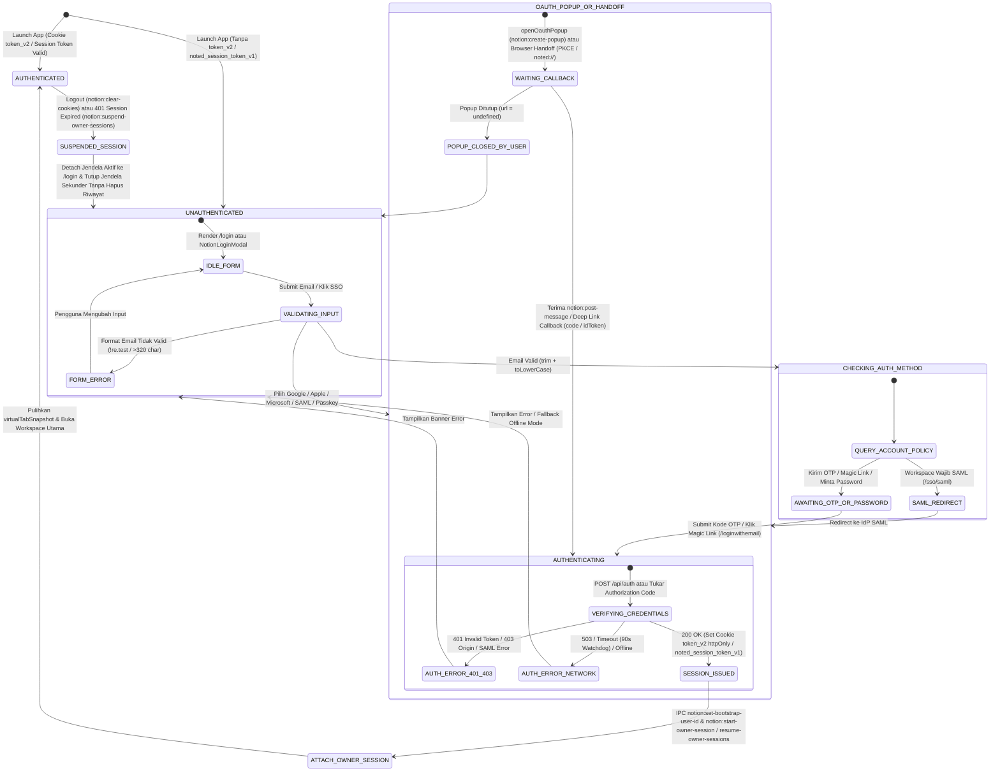
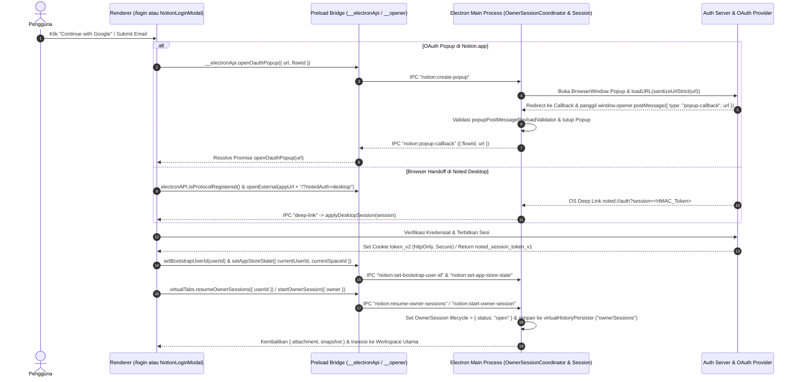

# Laporan Investigasi REA: Fitur Autentikasi & Form Login (`Notion.app` v7.39.0 & `Noted`)

**Tanggal Analisis:** 24 Oktober 2026  
**Agen Investigator:** `rea-scout`  
**Target Utama:** `/Applications/Notion.app` (`v7.39.0`, Electron `44.4.4`, `macArm64`)  
**Artefak ASAR Target:** `/Applications/Notion.app/Contents/Resources/app.asar` (SHA-256: `cebe52a8b18e8108ac60b4dbb91b7b0edab6fdd3f53be75fab582b532b66cbad`)  
**Target Pembanding (Lokal):** Workspace `Noted` (`/Users/daniakbar/Documents/REA-Projects/noted`)  
**Bukti REA (Evidence IDs):**
- `ev_972344632750b6d693e31dd3c457c0e19f3a0bb1008ca721d3a7e702081b0724` (`inspect_plist` pada `/Applications/Notion.app/Contents/Info.plist`)
- `ev_142243f678441f5e17d8de16aba0095415b35ad2ae5f102b60661c919c6e2aae` (`analyze_javascript_application` pada `app.asar`)
- `ev_48df8d3767a7394d292014e904dc0788e881b22d8544fec4f651be31cd4fe85d` (`inspect_electron_fuses` pada `Electron Framework`)
- `ev_c85b049cebe0ba135a6ba5e270f65f01d318bc6e6fea245dfb50dae032755857` (`trace_application_feature` seed `"login"`)

---

## 1. Ringkasan Fitur & Arsitektur Target

### 1.1 Arsitektur Autentikasi `Notion.app` (v7.39.0)
- **`[CONFIRMED]` Arsitektur Hibrida Electron Shell + Remote Web App (`https://app.notion.com` / `https://www.notion.so`):**
  Berdasarkan `config.json` dan `package.json` di dalam `app.asar`, aplikasi desktop Notion adalah multi-window Electron shell (`.webpack/main/index.js`, 4,34 MB) yang memuat aplikasi web Notion dari `domainBaseUrl: "https://app.notion.com"` (dengan migrasi otomatis dari `domainName: "www.notion.so"`) dan menyuntikkan jembatan preload `.webpack/renderer/tab_browser_view/preload.js` (`window.__electronApi`) serta `.webpack/renderer/popup/preload.js` (`window.__opener`).
- **`[CONFIRMED]` Enkripsi Kredensial & Hardening Fuse Tingkat OS:**
  Hasil `inspect_electron_fuses` (`ev_48df8d3767a7394d292014e904dc0788e881b22d8544fec4f651be31cd4fe85d`) membuktikan bahwa `EnableCookieEncryption` berstatus **`enabled`** (mengenkripsi cookie autentikasi seperti `token_v2` pada SQLite Chromium menggunakan kunci di macOS Keychain), `EnableEmbeddedAsarIntegrityValidation` **`enabled`**, dan `OnlyLoadAppFromAsar` **`enabled`**. Selain itu, modul `2788` di `.webpack/main/index.js` menggunakan `electron.safeStorage.encryptString` / `decryptString` untuk menyimpan kredensial push notification terenkripsi di `push-production-<userId>.blob`.
- **`[CONFIRMED]` Orkestrasi Multi-Metode Login:**
  Modul rute `55967` (`appRoutesExact`), `23205` (`authRoutesExact`), dan `31299` (`parseRoute` / `ve`) di `.webpack/main/index.js` mendefinisikan dukungan untuk:
  1. **Email (Magic Link / OTP Passcode / Password):** `/login`, `/loginwithemail`, `/email-confirm`, `/loginpasswordreset`, `/passwordresetcallback`.
  2. **OAuth 2.0 / OIDC (Google, Apple, Microsoft):** Popup internal via `openOauthPopup` (`/googlepopupredirect`, `/applepopupredirect`, `/microsoftpopupredirect`) maupun callback (`/oauth2callback`, `/appleauthcallback`, `/microsoftauthcallback`) serta `GoogleLoginController` (dedicated `BrowserWindow` ke `https://accounts.google.com`).
  3. **Enterprise SAML SSO:** `/sso/saml`, `/samlauthcallback`, `/completeSamlAuth`, `/native/samlauthcallback` dengan redaksi log otomatis (`redactSamlUrlForLogging` di modul `295`).
  4. **Passkey (WebAuthn):** `/passkeyauthverify`, `/passkeyauthcallback`, `/passkeyregistrationredirect`, `/passkeyregistrationverification`, `/passkeyregistrationcallback`.
  5. **Browser-to-Desktop Session Handoff (PKCE + Deep Link `notion://`):** `/browser-session-handoff-to-desktop` dan `/browser-session-handoff-to-desktop/callback` dengan deduplikasi SHA-256 pada kode otorisasi (`browserSessionHandoffDeeplinkDeduplicator`, modul `11607`).

### 1.2 Perbandingan Arsitektur dengan `Noted` Saat Ini
- **`[CONFIRMED]` Implementasi Autentikasi `Noted`:**
  Pada kode sumber lokal ([NotionLoginModal.jsx](file:///Users/daniakbar/Documents/REA-Projects/noted/src/components/Auth/NotionLoginModal.jsx), [auth.js](file:///Users/daniakbar/Documents/REA-Projects/noted/src/utils/auth.js), [session.js](file:///Users/daniakbar/Documents/REA-Projects/noted/src/utils/session.js), [api/auth.js](file:///Users/daniakbar/Documents/REA-Projects/noted/api/auth.js), dan [electron/session.cjs](file:///Users/daniakbar/Documents/REA-Projects/noted/electron/session.cjs)), `Noted` mengimplementasikan:
  1. **Google Identity Services (GIS) & Browser Handoff (`noted://auth?session=...`):** Verifikasi token ID Google di sisi server (`POST /api/auth` ke `https://oauth2.googleapis.com/tokeninfo`) dan penerbitan token sesi HMAC-SHA256 (`noted_session_token_v1`).
  2. **Akun Email Lokal (Offline Mode):** Pembuatan akun lokal (`loginWithEmail`) tanpa verifikasi kode OTP/password server.
  3. **Multi-Account Switcher (`noted_saved_accounts_v1`) & Guest Mode.**

---

## 2. Titik Masuk & Pemicu Aksi Pengguna (Entry Points)

### 2.1 Rute Autentikasi pada `Notion.app` (`[CONFIRMED]`)
Dari modul `55967` (`t.appRoutesExact`) dan `23205` (`t.authRoutesExact`) pada `.webpack/main/index.js` (offset `1129181` & `275000`):

| Kategori | Nama Rute | Path URL | Fungsi |
| :--- | :--- | :--- | :--- |
| **Form Login Utama** | `login` | `/login` | Layar masuk utama (input email, SSO, passkey) |
| **Produk Spesifik** | `loginAi` / `loginCalendar` / `loginMail` | `/login/ai`, `/login/calendar`, `/login/mail` | Titik masuk login per permukaan produk |
| **Email / OTP / Password** | `loginWithEmail` | `/loginwithemail` | Langkah verifikasi email/magic link/password |
| **Konfirmasi Email Desktop** | `desktopEmailConfirm` | `/email-confirm` | Konfirmasi email yang memicu deep link ke aplikasi desktop |
| **Reset Password** | `loginPasswordReset` / `passwordResetCallback` | `/loginpasswordreset`, `/passwordresetcallback` | Alur pemulihan kata sandi |
| **Multi-Akun** | `addAnotherAccountModal` | `/?target=add_another_account` | Menambahkan akun kedua/berikutnya di dalam sesi aktif |
| **Google OAuth** | `googlePopupRedirect` / `googleAuthCallback` | `/googlepopupredirect`, `/oauth2callback` | Inisiasi popup OAuth Google & penerimaan kode otorisasi |
| **Apple OAuth** | `applePopupRedirect` / `appleAuthCallback` | `/applepopupredirect`, `/appleauthcallback` | Sign in with Apple (popup & callback) |
| **Microsoft OAuth** | `microsoftPopupRedirect` / `microsoftAuthCallback` | `/microsoftpopupredirect`, `/microsoftauthcallback` | Sign in with Microsoft / Azure AD |
| **SAML SSO** | `samlAuth` / `samlAuthCallback` / `completeSamlAuth` | `/sso/saml`, `/samlauthcallback`, `/completeSamlAuth` | Autentikasi SAML Enterprise & penyelesaian sesi |
| **Passkey (WebAuthn)** | `passkeyAuthVerify` / `passkeyAuthCallback` | `/passkeyauthverify`, `/passkeyauthcallback` | Tantangan & verifikasi kriptografis Passkey |
| **Desktop Handoff** | `browserSessionHandoffToDesktop` / `Callback` | `/browser-session-handoff-to-desktop`, `/browser-session-handoff-to-desktop/callback` | Transfer sesi dari browser sistem ke aplikasi Electron via PKCE |
| **Validasi & Sinkronisasi** | `authValidate` / `syncUserSessionAuthCookies` | `/api/v3/authValidate`, `/syncCookies` | Validasi sesi aktif ke backend v3 & sinkronisasi cookie |
| **Logout** | `logout` | `/logout` | Terminasi sesi pengguna |

### 2.2 Jembatan IPC & Context Bridge Terkait Autentikasi (`[CONFIRMED]`)
Dari `.webpack/renderer/tab_browser_view/preload.js` (modul `1584` & `3739`), `.webpack/renderer/popup/preload.js`, dan `.webpack/main/index.js`:

1. **`window.__electronApi` (Preload Tab Utama):**
   - `openOauthPopup(options)` -> mengirim IPC `"notion:create-popup"` dan menunggu event `"notion:popup-callback"` berdasarkan `flowId`.
   - `closeOauthPopup({ flowId })` -> mengirim IPC `"notion:close-popup"`.
   - `getCookie(name)` -> invoke IPC `"notion:get-cookie"`.
   - `setCookie(cookieObj)` -> mengirim IPC `"notion:set-cookie"`.
   - `clearCookies()` -> mengirim IPC `"notion:clear-cookies"`.
   - `clearAllCookies()` -> mengirim IPC `"notion:clear-all-cookies"`.
   - `setBootstrapUserId(userId)` -> mengirim IPC `"notion:set-bootstrap-user-id"`.
   - `setAppStoreState(state)` -> mengirim IPC `"notion:set-app-store-state"`.
   - `virtualTabs.startOwnerSession(req)` -> invoke IPC `"notion:start-owner-session"`.
   - `virtualTabs.resumeOwnerSessions(req)` -> invoke IPC `"notion:resume-owner-sessions"`.
   - `virtualTabs.suspendOwnerSessions(req)` -> mengirim IPC `"notion:suspend-owner-sessions"`.
   - `virtualTabs.detachTabFromWindow(req)` / `"notion:detach-owner-session"`.
   - `virtualTabs.routeToOwnerSession(req)` -> mengirim IPC `"notion:route-to-owner-session"`.
2. **`window.__opener` (Preload Popup OAuth):**
   - `postMessage(payload, targetOrigin)` -> diekspos via `contextBridge.exposeInMainWorld("__opener", ...)` dan disuntikkan ke `window["opener"] = __opener`, meneruskan pesan ke main process melalui IPC `"notion:post-message"`.
3. **Skema Deep Link OS (`Info.plist`):**
   - Terbukti dari `inspect_plist` (`ev_972344632750b6d693e31dd3c457c0e19f3a0bb1008ca721d3a7e702081b0724`): `CFBundleURLSchemes: ["notion"]` ditangkap oleh `app.on("open-url", B.handleOpenUrl)` pada macOS dan `app.on("second-instance", ...)` pada Windows.

---

## 3. Payload Input & Alur Eksekusi per Metode Login

### 3.1 Metode 1: Login via Email (Langkah 1 Check Email -> Langkah 2 OTP / Magic Link / Password)
- **`[CONFIRMED]` Parameter Rute Awal (`/login`):**
  Berdasarkan parser rute `ve(e)` di modul `31299` (`.webpack/main/index.js`, offset `1551300`), rute `/login` menerima dan menormalisasi objek parameter berikut:
  ```json
  {
    "name": "login",
    "email": "string | undefined",
    "redirectURL": "string | undefined",
    "preserveLoginRouteOrigin": "boolean (query.preserveLoginRouteOrigin === 'true')",
    "addAnotherAccount": "boolean (query.addAnotherAccount === 'true')",
    "shouldRedirectForExistingUsersOnly": "boolean (query.shouldRedirectForExistingUsersOnly === 'true')"
  }
  ```
- **`[INFERRED]` Langkah 1 — Pemeriksaan Email & Penentuan Metode (`findUser` / `sendTemporaryPassword`):**
  Karena UI form `/login` dimuat secara dinamis dari bundel web `https://app.notion.com/login`, panggilan HTTP spesifik untuk pengecekan akun dilakukan di dalam web bundle jarak jauh. Berdasarkan struktur rute di modul `31299` (`requiredSamlError`, `loginWithEmailCallback`, `passkeyAuthVerify`), setelah pengguna memasukkan email:
  1. Klien menormalisasi email (`trim().toLowerCase()`) dan memeriksa kebijakan akun/organisasi (apakah wajib SAML SSO, mendukung password, atau menggunakan OTP/Magic Link).
  2. Bila organisasi mewajibkan SAML, klien diarahkan ke `/sso/saml` atau `/requiredSamlError?spaceId=<uuid>`.
  3. Bila menggunakan email login reguler, server mengirimkan kode OTP sekali pakai / tautan Magic Link dan klien beralih ke state verifikasi.
- **`[CONFIRMED]` Langkah 2 — Payload Callback `/loginwithemail` (`loginWithEmailCallback`):**
  Dari modul `31299` (offset `1553200`), ketika pengguna menyelesaikan verifikasi melalui kode/tautan atau password pada `/loginwithemail`, payload parameter yang diparsing adalah:
  ```json
  {
    "name": "loginWithEmailCallback",
    "state": "string (token state sesi login)",
    "password": "string (kode OTP sementara / password token)",
    "isSignup": "boolean (query.isSignup === 'true')",
    "redirectURL": "string | undefined (query.redirectUrl)",
    "webBrowserDeviceId": "string | undefined (query.di)",
    "isMicrosoft": "string | undefined",
    "loginRouteOrigin": "'login' | 'signup' | undefined"
  }
  ```
- **`[CONFIRMED]` Payload Reset Password (`/loginpasswordreset`):**
  Diparsing oleh modul `31299` menjadi:
  ```json
  {
    "name": "passwordResetCallback",
    "state": "string",
    "password": "string"
  }
  ```

### 3.2 Metode 2: OAuth 2.0 Popup & Callback (Google, Apple, Microsoft)
- **`[CONFIRMED]` Payload Pembentukan URL Redirect Popup (`createGooglePopupRedirect`, `createApplePopupRedirect`, `createMicrosoftPopupRedirect`):**
  Di dalam modul `31299` (offset `1530800`), fungsi pembentuk URL menerima parameter dan menghasilkan query string berikut:
  - **Google (`/googlepopupredirect`):**
    ```json
    {
      "callbackType": "string (t.authType.callbackType)",
      "email": "string | undefined",
      "contacts": "'true' | undefined",
      "redirectToAuth": "'true' | undefined",
      "source": "string | undefined",
      "requestId": "string | undefined",
      "authAction": "string | undefined",
      "desktopTabId": "string | undefined"
    }
    ```
  - **Apple (`/applepopupredirect`):**
    ```json
    {
      "callbackType": "string (t.authType.callbackType)",
      "redirectToAuth": "'true' | undefined",
      "tid": "string | undefined (getCrossOverDeviceId())"
    }
    ```
  - **Microsoft (`/microsoftpopupredirect`):**
    ```json
    {
      "callbackType": "string (t.authType.callbackType)",
      "redirectToAuth": "'true' | undefined",
      "source": "string | undefined",
      "desktopTabId": "string | undefined",
      "tid": "string | undefined (getCrossOverDeviceId())"
    }
    ```
- **`[CONFIRMED]` Alur Jendela Popup OAuth (`notion:create-popup` & `notion:post-message`):**
  1. Renderer memanggil `window.__electronApi.openOauthPopup({ url, title, width, height, flowId, navigationPolicy })` (modul `3739` di `tab_browser_view/preload.js`).
  2. Main process (`createPopup` di offset `279876`) memvalidasi bahwa `getEffectiveBaseUrl()` memiliki hostname valid, menghitung posisi tengah relatif terhadap jendela utama (`x = Math.round(e + n/2 - r/2)`, `y = Math.round(t + i/2 - o/2)`), dan membuat `BrowserWindow` baru dengan `preload: "../renderer/popup/preload.js"`, `sandbox: true`, `nodeIntegration: false`, dan `session: getSession()`.
  3. Saat penyedia OAuth melakukan redirect kembali ke halaman callback Notion di dalam popup, halaman tersebut memanggil `window.opener.postMessage({ type: "popup-callback", url, flowId })`.
  4. `popup/preload.js` meneruskan payload ke main process melalui IPC `"notion:post-message"`.
  5. Main process memvalidasi skema payload menggunakan `popupPostMessagePayloadValidator` (modul `17284`, offset `281598`):
     ```javascript
     t.popupPostMessagePayloadValidator = s.object({
       required: {
         type: s.literal("popup-callback"),
         url: s.string()
       },
       optional: {
         flowId: s.string()
       }
     });
     ```
  6. Main process memastikan `e.sender.id === T.webContents.id`, menutup jendela popup `T.close()`, dan mengirim event `"notion:popup-callback"` berisi `{ flowId, url: n.url }` ke tab pemanggil.
- **`[CONFIRMED]` Payload Callback OAuth setelah Decode `state` (Modul `31299`, offset `1545800`):**
  - **Google (`/oauth2callback`):** `state` didekode via `JSON.parse(w.decode(r.query.state))` menghasilkan:
    ```json
    {
      "name": "googleAuthCallback",
      "code": "string",
      "callbackType": "string (dari state.callbackType)",
      "encryptedToken": "string (dari state.encryptedToken)",
      "redirectUri": "string (dari state.redirectUri)",
      "source": "string (dari state.source)",
      "error": "string | undefined",
      "webBrowserDeviceId": "string | undefined (query.di)"
    }
    ```
  - **Apple (`/appleauthcallback`):**
    ```json
    {
      "name": "appleAuthCallback",
      "code": "string",
      "encryptedToken": "string (dari state.encryptedToken)",
      "encryptedNonce": "string (dari state.encryptedNonce)",
      "callbackType": "string (dari state.callbackType)",
      "encryptedUserObject": "string | undefined (query.encryptedUserObject)",
      "error": "string | undefined",
      "webBrowserDeviceId": "string | undefined (query.di)"
    }
    ```
  - **Microsoft (`/microsoftauthcallback`):**
    ```json
    {
      "name": "microsoftAuthCallback",
      "code": "string",
      "encryptedToken": "string (dari state.encryptedToken)",
      "encryptedNonce": "string (dari state.encryptedNonce)",
      "callbackType": "string (dari state.callbackType)",
      "state": "string",
      "source": "string (dari state.source)",
      "error": "string | undefined",
      "webBrowserDeviceId": "string | undefined (query.di)"
    }
    ```

### 3.3 Metode 3: Browser-to-Desktop Session Handoff (PKCE & Deep Link)
- **`[CONFIRMED]` Payload Inisiasi Handoff di Browser (`/browser-session-handoff-to-desktop`):**
  Berdasarkan modul `11215` (offset `1469000`) dan modul `31299` (offset `1547200`), ketika aplikasi desktop membuka browser sistem untuk login, URL handoff membawa parameter PKCE (Proof Key for Code Exchange) dan proteksi CSRF:
  ```json
  {
    "name": "browserSessionHandoffToDesktop",
    "csrfToken": "string (query.csrfToken)",
    "retryReason": "'csrf_retry' | undefined (query.retryReason)",
    "app": "string (query.app)",
    "state": "string | undefined (query.state)",
    "codeChallenge": "string | undefined (query.codeChallenge)",
    "codeChallengeMethod": "string | undefined (query.codeChallengeMethod)",
    "nativeSamlAuthVersion": "string | undefined (query.nativeSamlAuthVersion)"
  }
  ```
- **`[CONFIRMED]` Payload Callback Deep Link ke Desktop (`notion://.../browser-session-handoff-to-desktop/callback`):**
  Browser mengarahkan pengguna kembali ke protokol `notion://` dengan payload:
  ```json
  {
    "name": "browserSessionHandoffToDesktopCallback",
    "code": "string (one-time authorization code untuk ditukar dengan cookie sesi)"
  }
  ```
  Sebelum diproses, `browserSessionHandoffDeeplinkDeduplicator.shouldHandle(url)` (modul `11607`, offset `285000`) menghitung `SHA-256(code)` dan menyimpannya dalam antrean `recentCodeHashes` (maksimal 2 hash terakhir) untuk mencegah eksekusi ganda apabila OS mengirimkan event `open-url` dua kali.

### 3.4 Metode 4: SAML SSO & Passkey (WebAuthn)
- **`[CONFIRMED]` Payload Callback SAML SSO (`/samlauthcallback` & `/completeSamlAuth`):**
  Dari modul `31299` (offset `1553800`):
  ```json
  {
    "name": "samlAuthCallback",
    "userId": "string",
    "previousUserId": "string | undefined",
    "error": "string | undefined",
    "code": "string | undefined",
    "state": "string | undefined",
    "isNewSignup": "boolean (query.isNewSignup?.toLowerCase() === 'true')",
    "token": "string | undefined",
    "csrfState": "string | undefined",
    "redirectUrl": "string | undefined"
  }
  ```
  Dan untuk penyelesaian SAML (`completeSamlAuth`): `{ "name": "completeSamlAuth", "code": "string" }`.
- **`[CONFIRMED]` Payload Passkey / WebAuthn (`/passkeyauthverify` & `/passkeyauthcallback`):**
  Dari modul `31299` (offset `1548000`):
  - Verifikasi login: `{ "name": "passkeyAuthCallback", "attestation": "string", "attemptId": "string" }`.
  - Registrasi passkey: `{ "name": "passkeyRegistrationVerification", "callbackType": "string", "csrfToken": "string", "attemptId": "string", "options": "PublicKeyCredentialCreationOptions (JSON)" }` diikuti oleh `{ "name": "passkeyRegistrationCallback", "csrfToken": "string", "attemptId": "string", "response": "string" }`.

### 3.5 Perbandingan Payload Input pada `Noted` (`[CONFIRMED]`)
Pada aplikasi `Noted`:
1. **Google Login Web ([src/utils/auth.js:193-204](file:///Users/daniakbar/Documents/REA-Projects/noted/src/utils/auth.js#L193-L204) -> [api/auth.js:50-55](file:///Users/daniakbar/Documents/REA-Projects/noted/api/auth.js#L50-L55)):**
   - Request: `POST /api/auth` dengan body `{ "idToken": "<Google JWT Credential>" }`.
   - Response (`200 OK`): `{ "success": true, "session": "<base64url(payload)>.<hmac_sha256>", "user": { "id": "google_<sub>", "email": "...", "name": "...", "picture": "...", "avatar": "X", "color": "#2383e2", "isLoggedIn": true, "loginProvider": "google", "loggedInAt": 176... } }`.
2. **Desktop Browser Handoff ([NotionLoginModal.jsx:148](file:///Users/daniakbar/Documents/REA-Projects/noted/src/components/Auth/NotionLoginModal.jsx#L148) & [App.jsx:134-141](file:///Users/daniakbar/Documents/REA-Projects/noted/src/App.jsx#L134-L141)):**
   - Membuka `${appUrl}/?notedAuth=desktop` di browser eksternal, lalu setelah login mengarahkan ke `noted://auth?session=${encodeURIComponent(token)}` (tanpa PKCE `codeChallenge` / `state` sekali pakai).
3. **Email Offline Login ([NotionLoginModal.jsx:101-120](file:///Users/daniakbar/Documents/REA-Projects/noted/src/components/Auth/NotionLoginModal.jsx#L101-L120)):**
   - Memanggil `loginWithEmail(email.trim().toLowerCase())` secara sinkron di memori lokal tanpa panggilan jaringan.

---

## 4. Validasi Kredensial (Client-Side & Handler/Server)

### 4.1 Aturan Validasi di `Notion.app`
1. **`[CONFIRMED]` Validasi & Normalisasi Email (`oe(e)` di Modul `31299`, offset `1534500`):**
   Di dalam `.webpack/main/index.js`, Notion memvalidasi dan menormalisasi alamat email menggunakan fungsi:
   ```javascript
   const re = /^[^\s@]+@[^\s@]+\.[^\s@]+$/;
   function oe(e) {
     const t = e?.trim().toLowerCase();
     if (t && !(t.length > 320) && re.test(t)) return t;
   }
   ```
   - **Trimming & Case Normalization:** Selalu memanggil `.trim().toLowerCase()` terlebih dahulu.
   - **Batas Panjang Karakter:** Maksimal **320 karakter** (`!(t.length > 320)` sesuai standar RFC 3696/5321).
   - **Pola Regex:** `^[^\s@]+@[^\s@]+\.[^\s@]+$` (wajib memiliki bagian lokal tanpa spasi/`@`, simbol `@`, domain, dan TLD setelah titik).
   - **Dependensi Paket:** `package.json` di `app.asar` juga mendeklarasikan `"email-validator": "2.0.4"`.
2. **`[CONFIRMED]` Validasi UUID (`userId`, `spaceId`, `tabId`):**
   - Menggunakan `l.isUuidV4(e)` dan `s.uuid()` (modul validator `66515` di `.webpack/main/index.js`, offset `652123`) untuk memastikan `userId` dan `spaceId` pada setiap permintaan sesi adalah UUID v4 yang valid sebelum memproses `startOwnerSession`, `resumeOwnerSessions`, atau `suspendOwnerSessions`.
3. **`[CONFIRMED]` Validasi Navigasi & Allowlist Origin OAuth/SAML (Offset `567743` & Modul `80898`):**
   - `GoogleLoginController.isNavigationAllowed(url)` hanya mengizinkan origin `https://accounts.google.com`, `https://accounts.youtube.com`, `https://www.google.com`, atau hostname berakhiran `.google.com`, `.gstatic.com`, `.googleapis.com`.
   - Handler navigasi utama membatasi alur autentikasi eksternal pada daftar origin tepercaya (`f = ["https://accounts.google.com", "https://login.microsoftonline.com", "https://device.login.microsoftonline.com", "https://autologon.microsoftazuread-sso.com", ...]`) dan akhiran domain IdP SAML (`b = [".atlassian.com", ".okta.com", ".onelogin.com", ".jumpcloud.com", ".duosecurity.com"]`) serta endpoint ACS Google Workspace (`/^https:\/\/www\.google\.com\/a\/[^/]+\/acs([/?]|$)/`).
   - Sebelum membuka popup OAuth (`createPopup`), URL disanitasi dengan `l.sanitizeUrlStrict(t)`. Jika gagal, popup tidak memuat URL dan mencatat peringatan `Failed to sanitize URL for popup`.
4. **`[CONFIRMED]` Validasi Skema Payload IPC (`getTypedValue`):**
   Setiap pesan IPC dari renderer ke main process divalidasi dengan runtime schema validator (`s.object`, `s.literal`, `s.uuid`, `s.array`) melalui `(0, r.getTypedValue)(validator, request)`:
   - `popupPostMessagePayloadValidator` (wajib `type: "popup-callback"`, `url: string`).
   - `startOwnerSessionRequestValidator` (wajib `owner: { spaceId: uuid, userId: uuid }`).
   - `suspendOwnerSessionsRequestValidator` (wajib `reason: "logout" | "session-expired"`, `userIds: uuid[]`).
   - `resumeOwnerSessionsRequestValidator` (wajib `userId: uuid`).

### 4.2 Aturan Validasi di `Noted` (`[CONFIRMED]`)
1. **Validasi Client-Side pada `NotionLoginModal.jsx` ([baris 101-106](file:///Users/daniakbar/Documents/REA-Projects/noted/src/components/Auth/NotionLoginModal.jsx#L101-L106)):**
   - Input `<input type="email" required />` dengan pengecekan `if (!email || !email.includes('@'))` yang menampilkan pesan `"Masukkan alamat email yang valid."`.
   - Normalisasi `email.trim().toLowerCase()` saat diteruskan ke `loginWithEmail`.
   - State tombol submit dinonaktifkan (`disabled={isLoading}`) selama proses autentikasi berlangsung.
2. **Validasi Server-Side pada `api/auth.js` & `api/_lib/security.js`:**
   - **Validasi Origin (CORS):** `applyCors(req, res)` memeriksa header `Origin` terhadap `ALLOWED_ORIGINS` atau `isSameOrigin`. Menolak dengan `403 Origin not allowed` jika tidak cocok ([api/auth.js:30-32](file:///Users/daniakbar/Documents/REA-Projects/noted/api/auth.js#L30-L32)).
   - **Validasi Format Email Server:** `isValidEmail` di [api/_lib/security.js:166-167](file:///Users/daniakbar/Documents/REA-Projects/noted/api/_lib/security.js#L166-L167) memeriksa `typeof value === 'string' && value.length <= 254 && /^[^\s@]+@[^\s@]+\.[^\s@]+$/.test(value)`.
   - **Validasi Token Google:** Memastikan `idToken.trim()` tidak kosong (`400`), memverifikasi ke `https://oauth2.googleapis.com/tokeninfo?id_token=...` (`401`), mencocokkan `payload.aud` terhadap `GOOGLE_CLIENT_ID` (`401`), dan memastikan `payload.email_verified !== 'false'` (`401`).

---

## 5. Mekanisme Token, Cookie, & Manajemen Sesi

### 5.1 Mekanisme Sesi & Cookie di `Notion.app` (`[CONFIRMED]`)
1. **Cookie Sesi Utama (`token_v2`) dan Identitas Perangkat (`device_id`):**
   - Dari fungsi `migrateDomainIfNeeded` di `.webpack/main/index.js` (offset `318510`–`323134`), status autentikasi pengguna di Electron ditentukan oleh keberadaan cookie **`token_v2`** di dalam Electron `Session` (`const b = i.some(e => "token_v2" === e.name)`).
   - Cookie `token_v2` disimpan dengan atribut keamanan `secure: true`, `httpOnly: true`, `path: "/"`, `sameSite`, dan `expirationDate`, lalu di-flush ke disk melalui `session.cookies.flushStore()`.
   - Karena `token_v2` bersifat `httpOnly: true`, handler IPC `"notion:get-cookie"` di main process (offset `272715`) secara eksplisit memblokir pembacaan cookie `httpOnly` oleh renderer:
     ```javascript
     h.handleRequestFromRenderer.addListener("notion:get-cookie", async (e, t) => {
       const { cookies: n } = (0, b.getSession)(),
         [r] = await n.get({ url: (0, m.getEffectiveBaseUrl)(), name: t });
       return { value: r && !r.httpOnly ? r.value : void 0 };
     });
     ```
2. **Partisi Sesi Electron (`getElectronSessionPartition`):**
   - Modul pada offset `566369` mengelola partisi sesi melalui `session.fromPartition((0, h.getElectronSessionPartition)())`.
   - Jika argumen CLI `--notion-ephemeral-session=1` aktif (`isEphemeralSessionActive()`), Notion menggunakan partisi in-memory `"notion-ephemeral"` (dan `"gdrive-ephemeral"` untuk Google Drive) sehingga cookie/sesi tidak ditulis ke disk. Pada mode normal, digunakan partisi persisten default yang dienkripsi oleh OS Keychain (`EnableCookieEncryption: enabled`).
3. **Pembersihan Cookie saat Logout (`notion:clear-cookies` & `notion:clear-all-cookies`):**
   - Pada offset `272329`–`272800`, saat pengguna melakukan logout:
     ```javascript
     h.handleEventFromRenderer.addListener("notion:clear-cookies", async () => {
       const [e] = await (0, b.getSession)().cookies.get({ name: "device_id" });
       (0, b.getSession)().clearStorageData({
         origin: (0, m.getEffectiveBaseUrl)(),
         storages: ["cookies"]
       });
       e && await (0, b.getSession)().cookies.set({
         name: "device_id",
         value: e.value,
         url: (0, m.getEffectiveBaseUrl)(),
         expirationDate: e.expirationDate,
         httpOnly: !0
       });
     });
     ```
   - Notion menghapus seluruh cookie pada origin aplikasi (termasuk `token_v2`), **namun sengaja mempertahankan cookie `device_id` (`httpOnly: true`)** agar identitas perangkat tetap konsisten lintas sesi login.
4. **Manajemen Siklus Hidup `OwnerSession` & Multi-Window (`OwnerSessionCoordinator`, Modul `95566`, offset `130550`):**
   - Setiap jendela kerja (workspace window) diikat ke `OwnerSession` yang memiliki identitas `owner: { userId: uuid, spaceId: uuid }` dan disimpan secara persisten di `virtualHistoryPersister.set("ownerSessions", e)`.
   - Tiga status siklus hidup (`savedOwnerSessionValidator`, offset `652123`):
     - `open`: `{ status: "open" }`
     - `suspended`: `{ status: "suspended", reason: "logout" | "owner-unavailable" | "session-expired", suspendedAt: number }`
     - `closed`: `{ status: "closed", closedAt: number }`
   - **Saat Login (`startOwnerSession` / `resumeOwnerSessions`):**
     Renderer memanggil `startOwnerSession({ owner: { userId, spaceId } })` atau `resumeOwnerSessions({ userId })`. `OwnerSessionCoordinator.resumeForUser` mencari sesi `suspended` milik `userId` tersebut (yang bukan `owner-unavailable`), memulihkan snapshot tab virtual (`virtualTabSnapshot`) ke jendela aktif, membuka kembali jendela tambahan milik user tersebut (`ensureSessionWindow`), dan mengubah status menjadi `{ status: "open" }`.
   - **Saat Logout atau Session Expired (`suspendOwnerSessions`):**
     Renderer mengirim IPC `"notion:suspend-owner-sessions"` dengan `{ reason: "logout" | "session-expired", userIds: [userId] }`. `OwnerSessionCoordinator.suspend` melakukan:
     1. Melepaskan (`detachOwnerSessionThunk`) sesi dari jendela tempat pengguna memicu logout sehingga jendela tersebut dapat menampilkan halaman `/login`.
     2. Melakukan flush snapshot tab pada seluruh jendela lain milik `userId` tersebut (`flushVirtualTabSnapshots`), lalu menutup jendela-jendela sekunder itu tanpa menghapus riwayat tabnya (`closeWindowWithoutHistory`) dengan status `suspended`.

### 5.2 Mekanisme Token & Sesi di `Noted` (`[CONFIRMED]`)
1. **Penerbitan Token (`signSession` di [api/_lib/security.js:104-120](file:///Users/daniakbar/Documents/REA-Projects/noted/api/_lib/security.js#L104-L120)):**
   - Format token: `<base64url(JSON.stringify(payload))>.<base64url(HMAC_SHA256(payloadB64, SESSION_SECRET))>`.
   - Struktur `payload`: `{ sub, email, name, picture, iat, exp }` dengan masa berlaku (`ttlSeconds`) default **30 hari** (`60 * 60 * 24 * 30 = 2.592.000` detik).
2. **Verifikasi Token ([api/_lib/security.js:125-146](file:///Users/daniakbar/Documents/REA-Projects/noted/api/_lib/security.js#L125-L146) & [electron/session.cjs:18-37](file:///Users/daniakbar/Documents/REA-Projects/noted/electron/session.cjs#L18-L37)):**
   - Memisahkan `payloadB64` dan `signature`, menghitung ulang HMAC-SHA256 dengan `SESSION_SECRET`, membandingkan digest menggunakan **`crypto.timingSafeEqual`** (mencegah timing side-channel), lalu memeriksa `payload.sub`, `payload.email`, dan `payload.exp >= Math.floor(Date.now() / 1000)`.
3. **Penyimpanan Client-Side (`localStorage`):**
   - `noted_session_token_v1` ([src/utils/session.js:5](file:///Users/daniakbar/Documents/REA-Projects/noted/src/utils/session.js#L5)): Menyimpan token sesi aktif dan mengirimkannya sebagai header `Authorization: Bearer <token>`.
   - `noted_current_user_v1` ([src/utils/comments.js](file:///Users/daniakbar/Documents/REA-Projects/noted/src/utils/comments.js)): Menyimpan profil pengguna aktif (`id`, `name`, `email`, `picture`, `avatar`, `color`, `isLoggedIn`, `loginProvider`).
   - `noted_saved_accounts_v1` ([src/utils/auth.js:65](file:///Users/daniakbar/Documents/REA-Projects/noted/src/utils/auth.js#L65)): Menyimpan daftar akun yang pernah login beserta token `session` masing-masing untuk fitur perpindahan akun (`switchAccount`).
4. **Pembersihan Saat Logout ([src/utils/auth.js:364-385](file:///Users/daniakbar/Documents/REA-Projects/noted/src/utils/auth.js#L364-L385)):**
   - `logout()` menghapus `noted_session_token_v1` (`clearSessionToken()`), mereset `noted_current_user_v1` ke `DEFAULT_USER` dengan `isLoggedIn: false, loginProvider: 'guest'`, dan memancarkan `CustomEvent('noted_auth_changed')`.
   - `logoutAllAccounts()` menghapus `noted_saved_accounts_v1` lalu memanggil `logout()`.

---

## 6. Penanganan Error (401, Rate Limit, & Koneksi/Offline)

### 6.1 Penanganan Error di `Notion.app`
1. **`[CONFIRMED]` Kredensial Tidak Valid / Sesi Kedaluwarsa (`401` / `session-expired`) & Enforced SSO/MFA:**
   - Ketika sesi tidak lagi valid di server, aplikasi memicu IPC `"notion:suspend-owner-sessions"` dengan `reason: "session-expired"` (divalidasi oleh `suspendOwnerSessionsRequestValidator`, offset `653020`), membekukan snapshot tab pengguna dan mengarahkan jendela aktif ke `/login`.
   - Ketika pengguna mencoba mengakses workspace yang mewajibkan SAML SSO atau MFA tanpa sesi yang sesuai, router mengarahkan ke rute khusus `/requiredSamlError?spaceId=<uuid>`, `/requiredMfaError`, atau `/ekmError` (modul `31299`, offset `1552200`).
   - Pada alur OAuth/SAML callback (`/oauth2callback`, `/appleauthcallback`, `/microsoftauthcallback`, `/samlauthcallback`), parameter `error` dan `errorMessage` pada query string diparsing secara eksplisit oleh modul `31299` untuk ditampilkan sebagai banner gagal autentikasi di layar `/login`.
   - Pada handoff browser-ke-desktop, jika terjadi ketidakcocokan token CSRF, rute `/browser-session-handoff-to-desktop` menerima parameter `retryReason=csrf_retry` (`BROWSER_SESSION_HANDOFF_TO_DESKTOP_CSRF_RETRY_REASON` di modul `86860`) untuk mengulang handshake secara otomatis.
2. **`[CONFIRMED]` Penanganan Kondisi Offline, Timeout (90 Detik), & Gagal Muat Halaman:**
   - **Page Loading Watchdog (90 Detik):** Pada `TabController.setupPageLoadingWatchdog()` (offset `177253`), Notion memasang timer `90.000 ms` (`9e4`). Jika halaman autentikasi/workspace gagal selesai dimuat dalam 90 detik, dicatat log ke `serverLoggerForOffline` dengan tipe `"pageLoadingTimeout"` (`"Page took longer than 90 seconds to load"`).
   - **Event `did-fail-load` & Blank Tab Diagnostic Restart:** Pada offset `153019`, setiap kegagalan pemuatan frame utama (`errorCode !== -3` / bukan `ERR_ABORTED`) memicu `recordBlankTabDiagnosticRestartMilestone("navigation_failed", { tabId, errorCode })`.
   - **Dialog & Indikator Offline Native:** Berdasarkan `i18n/default/messages.json` dan offset `93436`, ketika gagal memuat saat offline, pengguna ditampilkan pesan `window.loadingError.message`: *"Error loading Notion, connect to the internet to get started."* dengan tombol *"Reload"* dan *"Cancel"*, serta indikator tab bar `desktop.tabBar.offlineIndicatorLabel`: *"No internet connection"*.
   - **Klasifikasi Error Jaringan & HTTP (`403` / `503` / `ECONNREFUSED`):** Pada offset `243000`, Notion membedakan error jaringan lokal (`ERR_CONNECTION_REFUSED`, `ECONNREFUSED`, `net::ERR*`), `403` (`cloudflareCaptcha`), dan `503` (`serviceUnavailable`).
3. **`[UNKNOWN]` Detail Pesan UI Spesifik untuk HTTP `429 Too Many Requests` pada Form OTP:**
   - **Alasan & Bukti:** Komponen React form input OTP dan penangan respons HTTP `429` pada endpoint `/api/v3/sendTemporaryPassword` atau `/api/v3/loginWithEmail` disajikan dari bundel web jarak jauh (`https://app.notion.com`) dan tidak dibundel secara statis di dalam `app.asar`. Untuk mengonfirmasi teks pesan dan durasi cooldown `Retry-After` pada `429`, diperlukan observasi jaringan runtime (`inspect_web_network_capture`) terhadap server produksi Notion.

### 6.2 Penanganan Error di `Noted` (`[CONFIRMED]`)
Dari `describeAuthError(status, serverMessage)` di [src/utils/auth.js:164-186](file:///Users/daniakbar/Documents/REA-Projects/noted/src/utils/auth.js#L164-L186) dan [api/auth.js:24-106](file:///Users/daniakbar/Documents/REA-Projects/noted/api/auth.js#L24-L106):

| Kondisi Error | Status HTTP | Respons Server (`api/auth.js`) | Pesan UI Klien (`describeAuthError` / `NotionLoginModal`) |
| :--- | :--- | :--- | :--- |
| Email kosong / tanpa `@` | Client-side | *(Tidak dikirim ke server)* | `"Masukkan alamat email yang valid."` |
| `idToken` kosong | `400` | `Missing Google credential token` | `"Missing Google credential token"` |
| Token Google tidak valid / kedaluwarsa | `401` | `Google credential could not be verified` | `"Kredensial Google ditolak server. Coba login ulang, dan pastikan GOOGLE_CLIENT_ID di server sama dengan yang di aplikasi."` |
| `aud` token tidak cocok dengan Client ID | `401` | `Google credential was issued for a different application` | Menampilkan pesan server di komponen `.notion-login-error` |
| Email Google belum terverifikasi | `401` | `Google account email is not verified` | Menampilkan pesan server di komponen `.notion-login-error` |
| Origin aplikasi tidak ada di `ALLOWED_ORIGINS` | `403` | `Origin not allowed` | `"Origin aplikasi belum diizinkan server. Tambahkan origin ini ke ALLOWED_ORIGINS di environment server."` |
| `SESSION_SECRET` / `GOOGLE_CLIENT_ID` belum diset | `503` | `Server is not configured...` | `"Server belum dikonfigurasi untuk sesi login. Set SESSION_SECRET di environment server (Vercel), lalu deploy ulang."` |
| Gagal menghubungi Google `tokeninfo` / Offline | `500` / Network Error | `Failed to verify Google credential` | Ditangkap oleh `catch (err)` di `NotionLoginModal.jsx` dan ditampilkan di banner `.notion-login-error`; sinkronisasi otomatis beralih ke `offline_vault`. |
| Protokol `noted://` belum terdaftar di OS | Client-side IPC | `isProtocolRegistered() -> { registered: false }` | `"Aplikasi desktop ini belum terdaftar sebagai penangan noted://, jadi sesi tidak bisa dikembalikan ke sini..."` |

---

## 7. Penyimpanan Status Login & Transisi State Machine

### 7.1 Diagram State Machine Autentikasi & Sesi (`[CONFIRMED]` & `[INFERRED]`)
Berikut adalah state machine lengkap yang menggabungkan alur form login (UI) dan siklus hidup sesi desktop (`OwnerSessionCoordinator` pada `Notion.app` serta state autentikasi pada `Noted`):



### 7.2 Diagram Sekuens Transisi dari Login ke Workspace Utama (`[CONFIRMED]`)



---

## 8. Daftar Temuan (`CONFIRMED` / `INFERRED` / `UNKNOWN`) & Bukti REA

| ID | Status | Temuan Kunci | Bukti Konkret & Lokasi Artefak |
| :--- | :--- | :--- | :--- |
| **F-01** | `[CONFIRMED]` | `Notion.app` v7.39.0 mendaftarkan skema URL deep-link `notion://` (`CFBundleURLSchemes: ["notion"]`, `CFBundleIdentifier: "notion.id"`) untuk menangkap callback autentikasi eksternal dari browser OS. | REA `inspect_plist` (`ev_972344632750b6d693e31dd3c457c0e19f3a0bb1008ca721d3a7e702081b0724`) pada `/Applications/Notion.app/Contents/Info.plist`. |
| **F-02** | `[CONFIRMED]` | Cookie autentikasi di `Notion.app` dienkripsi saat disimpan di disk menggunakan kunci di macOS Keychain melalui Electron Fuse `EnableCookieEncryption: enabled`, dan integritas kode dilindungi oleh `EnableEmbeddedAsarIntegrityValidation: enabled` serta `OnlyLoadAppFromAsar: enabled`. | REA `inspect_electron_fuses` (`ev_48df8d3767a7394d292014e904dc0788e881b22d8544fec4f651be31cd4fe85d`) pada `/Applications/Notion.app/Contents/Frameworks/Electron Framework.framework`. |
| **F-03** | `[CONFIRMED]` | Selain cookie, kredensial push notification desktop disimpan terenkripsi dengan `electron.safeStorage.encryptString` / `decryptString` pada file `push-production-<userId>.blob` dengan penulisan atomik `.tmp` -> `rename` dan mode izin `0o600` (`384`). | `.webpack/main/index.js` di dalam `app.asar`, Modul `2788` (offset `282667`: `loadDesktopNotificationCredentials` & `saveDesktopNotificationCredentials`). |
| **F-04** | `[CONFIRMED]` | Cookie sesi utama yang menentukan apakah pengguna sudah terautentikasi di `Notion.app` bernama **`token_v2`** (`httpOnly: true`, `secure: true`), didampingi cookie identitas perangkat **`device_id`** (`httpOnly: true`). | `.webpack/main/index.js` di dalam `app.asar`, fungsi `migrateDomainIfNeeded` (offset `318510`–`323134`) dan handler IPC `"notion:clear-cookies"` (offset `272329`). |
| **F-05** | `[CONFIRMED]` | Renderer tidak dapat membaca cookie `httpOnly` (seperti `token_v2`) melalui IPC karena handler `"notion:get-cookie"` menerapkan filter `r && !r.httpOnly ? r.value : void 0`. | `.webpack/main/index.js` di dalam `app.asar`, offset `272715`. |
| **F-06** | `[CONFIRMED]` | Saat logout (`"notion:clear-cookies"` / `"notion:clear-all-cookies"`), Notion menghapus seluruh cookie di `session.clearStorageData({ storages: ["cookies"] })` tetapi membaca dan menulis ulang cookie `device_id` agar identitas perangkat tetap bertahan. | `.webpack/main/index.js` di dalam `app.asar`, offset `272329`–`272750`. |
| **F-07** | `[CONFIRMED]` | Aturan validasi email di `Notion.app` melakukan `.trim().toLowerCase()`, membatasi panjang maksimal **320 karakter** (`!(t.length > 320)`), dan menguji regex `/^[^\s@]+@[^\s@]+\.[^\s@]+$/`. | `.webpack/main/index.js` di dalam `app.asar`, Modul `31299`, fungsi `oe(e)` (offset `1534500`). |
| **F-08** | `[CONFIRMED]` | Popup OAuth di `Notion.app` dijalankan di `BrowserWindow` terisolasi (`sandbox: true`, `nodeIntegration: false`) menggunakan `popup/preload.js` yang mengekspos `window.__opener.postMessage` -> IPC `"notion:post-message"`, divalidasi dengan `popupPostMessagePayloadValidator` (`{ type: "popup-callback", url, flowId? }`), lalu meneruskan URL callback ke tab pemanggil via `"notion:popup-callback"`. | `.webpack/main/index.js` (offset `279876`, Modul `17284` offset `281598`), `.webpack/renderer/popup/preload.js` (offset `359420`), dan `.webpack/renderer/tab_browser_view/preload.js` (Modul `3739`). |
| **F-09** | `[CONFIRMED]` | Browser-to-Desktop session handoff di `Notion.app` (`/browser-session-handoff-to-desktop`) menggunakan parameter PKCE (`codeChallenge`, `codeChallengeMethod`, `state`, `csrfToken`) dan mendeduplikasi kode callback menggunakan hash SHA-256 (`browserSessionHandoffDeeplinkDeduplicator`). | `.webpack/main/index.js` di dalam `app.asar`, Modul `11215` (offset `1469000`), Modul `31299` (offset `1547200`), dan Modul `11607` (offset `285000`). |
| **F-10** | `[CONFIRMED]` | `Notion.app` menyensor seluruh parameter sensitif SAML (`relaystate`, `samlrequest`, `samlresponse`, `sigalg`, `signature`) dari URL sebelum ditulis ke log aplikasi melalui `redactSamlUrlForLogging`. | `.webpack/main/index.js` di dalam `app.asar`, Modul `295` (offset `1620356`). |
| **F-11** | `[CONFIRMED]` | Siklus hidup sesi per jendela di `Notion.app` dikelola oleh `OwnerSessionCoordinator` dengan state `open`, `suspended` (`reason: "logout" | "owner-unavailable" | "session-expired"`), dan `closed`, yang memungkinkan seluruh tab dan jendela pengguna dipulihkan otomatis (`resumeOwnerSessions`) saat pengguna login kembali. | `.webpack/main/index.js` di dalam `app.asar`, Modul `95566` (offset `130550`–`138500`), Modul `18047` (offset `369315`), dan Modul `651574`. |
| **F-12** | `[CONFIRMED]` | `Noted` saat ini mengimplementasikan verifikasi token Google OAuth di sisi server ([api/auth.js](file:///Users/daniakbar/Documents/REA-Projects/noted/api/auth.js)) dan menerbitkan token sesi HMAC-SHA256 berumur 30 hari (`noted_session_token_v1`) yang diverifikasi menggunakan `crypto.timingSafeEqual` ([api/_lib/security.js](file:///Users/daniakbar/Documents/REA-Projects/noted/api/_lib/security.js), [electron/session.cjs](file:///Users/daniakbar/Documents/REA-Projects/noted/electron/session.cjs)), sedangkan login email berfungsi sebagai akun offline lokal ([src/utils/auth.js](file:///Users/daniakbar/Documents/REA-Projects/noted/src/utils/auth.js)). | [NotionLoginModal.jsx](file:///Users/daniakbar/Documents/REA-Projects/noted/src/components/Auth/NotionLoginModal.jsx), [src/utils/auth.js](file:///Users/daniakbar/Documents/REA-Projects/noted/src/utils/auth.js), [src/utils/session.js](file:///Users/daniakbar/Documents/REA-Projects/noted/src/utils/session.js), [api/auth.js](file:///Users/daniakbar/Documents/REA-Projects/noted/api/auth.js), [api/_lib/security.js](file:///Users/daniakbar/Documents/REA-Projects/noted/api/_lib/security.js). |
| **F-13** | `[INFERRED]` | Langkah pemeriksaan metode login setelah submit email pada layar `/login` di `Notion.app` (penentuan apakah akun menerima OTP/Magic Link, Password, atau wajib redirect ke SAML) dieksekusi oleh komponen web yang dimuat dari `https://app.notion.com/login` dan berinteraksi dengan rantai rute `/loginwithemail` serta `/requiredSamlError`. | Disimpulkan dari struktur parser rute `ve(e)` di Modul `31299` (`.webpack/main/index.js`, offset `1551300`–`1554000`) dan absennya bundel UI `/login` statis di dalam `app.asar`. |
| **F-14** | `[UNKNOWN]` | Struktur payload JSON internal pada body request ke endpoint `/api/v3/sendTemporaryPassword` / `/api/v3/loginWithEmail` serta format kode error spesifik untuk rate limit HTTP `429` pada server `https://app.notion.com`. | Bundel UI form `/login` dimuat secara remote dari `https://app.notion.com` saat runtime dan tidak tersimpan di dalam `app.asar`. Memerlukan tangkapan jaringan runtime (`inspect_web_network_capture`) untuk verifikasi penuh. |
