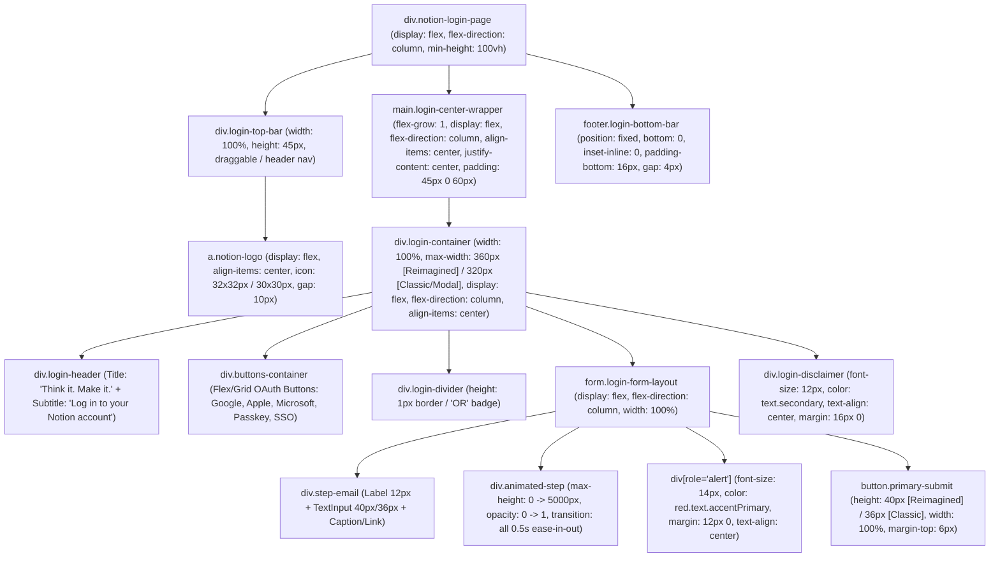

# Laporan Inspeksi UI & Spesifikasi Visual: Layar Login & Autentikasi Notion (`ui-login`)

> **Target Inspeksi**: `/Applications/Notion.app` (`Contents/Resources/app.asar` — SHA-256: `cebe52a8b18e8108ac60b4dbb91b7b0edab6fdd3f53be75fab582b532b66cbad`) & Bundel Web/Desktop Notion (`login-30488e2149b96529.js`, `7d8859a0e6a86f01.js`, `29eeb3945026bdad.js`, `739fc5e2831e436a.js`, `77281.css`, `main.css`)
> **Evidence Bundle ID (REA)**: `ev_94ffeb18efdd377c7569bb4a7ddd5be9f1f4bb59779f43fab1722f7101f2e1f9`
> **Komponen Lokal Terkait di Workspace (`Noted`)**:
> - [NotionLoginModal.jsx](file:///Users/daniakbar/Documents/REA-Projects/noted/src/components/Auth/NotionLoginModal.jsx)
> - [NotionLoginModal.css](file:///Users/daniakbar/Documents/REA-Projects/noted/src/components/Auth/NotionLoginModal.css)
> - [index.css](file:///Users/daniakbar/Documents/REA-Projects/noted/src/index.css)
> - [plan-ui.md](file:///Users/daniakbar/Documents/REA-Projects/noted/plan-ui.md)

---

## 1. Hierarki Layout & Struktur Kontainer (DOM, Flexbox & Grid)

Berdasarkan hasil dekompilasi dan ekstraksi bundel renderer Electron (`.webpack/renderer/tabs/index.js`) serta bundel chunk autentikasi Notion (`13195` / modul `949204`, `352668`, `121787`, `413522`, dan `813515`), Notion memiliki **tiga konteks kontainer utama** untuk antarmuka Login (Desktop/Web Fullscreen Page, Multi-Account Login Modal, dan Mobile Native), yang semuanya merender inti komponen `<LoginForm />` (modul `413522`).

### 1.1 Diagram Hierarki DOM & Layout



### 1.2 Spesifikasi Kontainer Berdasarkan Varian Layar

#### A. Desktop App & Web Full-Page Login (Modul `949204` — `loginDesktopPage`)
Digunakan saat pengguna membuka `/login` di web atau saat aplikasi `/Applications/Notion.app` belum memiliki sesi aktif:
```css
/* 1. Outer Root Wrapper (style0) */
.notion-login-desktop-page {
  min-height: 100vh;
  height: 100%;
  display: flex;
  flex-direction: column;
  overflow: auto;
  background-color: var(--c-bacPri); /* Light: #FFFFFF, Dark: #191919 */
  color: var(--c-texPri);            /* Light: #2C2C2B, Dark: #F0EFED */
}

/* 2. Top Window / Header Bar (style1) */
.notion-login-top-bar {
  width: 100%;
  height: 45px; /* Pada Web Header dengan Language Picker: height: 80px, padding: 0 24px */
  flex-shrink: 0;
  -webkit-app-region: drag; /* Khusus Electron macOS agar window dapat digeser */
}

/* 3. Main Centered Flex Container (style2) */
.notion-login-main-center {
  flex-grow: 1;
  display: flex;
  flex-direction: column;
  align-items: center;
  justify-content: center;
  width: 100%;
  height: 100%;
  padding-top: 45px;
  padding-bottom: 60px;
  user-select: none;
}

/* 4. Fixed Bottom Footer Bar (style3 + Modul 910839) */
.notion-login-bottom-bar {
  position: fixed;
  bottom: 0;
  inset-inline: 0;
  padding-bottom: 16px;
  display: flex;
  flex-direction: column;
  align-items: center;
  justify-content: center;
  gap: 4px;
  line-height: 1.2;
  background-color: var(--c-bacPri);
  font-size: 12px;
  color: var(--c-texSec);
}
```

#### B. Core Form Container (Modul `413522` — `LoginForm` `q.container`)
Notion menggunakan flag internal `isReimaginedLoginPage: true` pada layar login modern dan `false` pada layar modal klasik:
- **Reimagined Login Container (`isReimaginedLoginPage: true`)**:
  - `width: 100%`
  - `max-width: 360px`
  - `display: flex; flex-direction: column; align-items: center;`
- **Classic / Modal Login Container (`isReimaginedLoginPage: false` / `LoginModalContent` modul `352668`)**:
  - `width: 100%`
  - `max-width: 320px` (Mobile: `max-width: 343px`, Mobile Wide: `max-width: 414px`)
  - `display: flex; flex-direction: column; align-items: center;`

#### C. Multi-Account / Workspace Login Modal (Modul `813515` & `352668` — `AddAnotherAccountLoginModal`)
Digunakan ketika pengguna menekan *"Add another account"* atau membuka dialog autentikasi di dalam workspace (serupa dengan [NotionLoginModal.jsx](file:///Users/daniakbar/Documents/REA-Projects/noted/src/components/Auth/NotionLoginModal.jsx) pada aplikasi `Noted`):
- **Modal Dialog Constraint (`areaConstraint`)**:
  - `width: 480px` (fixed width pada Notion Desktop; pada `Noted` saat ini menggunakan `max-width: 440px`).
  - `background-color`: `background.elevated` (`#FFFFFF` pada Light Mode, `#202020` pada Dark Mode).
  - `border-radius`: `12px` (Modal shell standar Notion).
  - `box-shadow`: `modalBoxShadow` (lihat Tabel 2.5).
- **Tombol Cancel (`style0` pada modul `813515`)**:
  - `position: absolute; inset-inline-end: 0; margin-top: 16px; margin-inline-end: 16px; font-size: 14px; color: var(--c-texSec); cursor: pointer; z-index: 1;`
- **Modal Title (`style1` pada modul `352668`)**:
  - `font-size: 28px; font-weight: 600; line-height: 1.1; text-align: center; margin-top: 90px;` (Mobile: `margin-top: 30px`).
- **Modal Description (`style2` pada modul `352668`)**:
  - `font-size: 14px; color: var(--c-texSec); width: 350px; margin-top: 12px; margin-bottom: 20px; line-height: 1.3; text-align: center;`
- **Modal Form Inner Wrapper (`style4` pada modul `352668`)**:
  - `width: 100%; max-width: 320px; margin: 0 auto 72px auto;`

### 1.3 Urutan Vertikal Elemen & Jarak Antar Blok (Spacing/Gaps)

| Urutan | Elemen UI | Dimensi & Jarak Vertikal (`margin` / `gap`) | Layout CSS |
| :--- | :--- | :--- | :--- |
| **1** | **Top Header / Logo Notion** | Tinggi bar `45px` (Desktop) / `80px` (Web). Ikon logo `32x32px` (`>1020px`) atau `30x30px` (`<=1020px`), `margin-inline-end: 10px` ke teks `"Notion"` (`16px`, `font-weight: 500`). | `display: flex; align-items: center;` |
| **2** | **Heading Utama & Subjudul** | Heading utama: `"Think it. Make it."` + Subjudul: `"Log in to your Notion account"`. Jarak bawah ke blok form: `margin-bottom: 24px`. | `display: flex; flex-direction: column;` |
| **3** | **Kontainer Tombol OAuth / SSO** | `gap: 8px` (tumpukan vertikal full-width) atau `gap: 12px` (Reimagined Grid/Flex tile `buttonsContainer`). | `display: flex; flex-direction: column; gap: 8px;` atau `grid-template-columns: repeat(3, minmax(0, 1fr)); gap: 12px;` |
| **4** | **Divider Pemisah (`OR`)** | `margin-top: 16px; margin-bottom: 16px;` (atau `margin: 20px 0` di antara grup SSO dan form Email). Tinggi garis `1px`. | `display: flex; align-items: center; width: 100%;` |
| **5** | **Form Email (`<form>`)** | Label (`margin-bottom: 4px` klasik / `8px` reimagined) -> Input (`margin-top: 4px; margin-bottom: 8px` atau `16px` tanpa caption) -> Caption bantuan (`margin-top: 4px; margin-bottom: 12px`). | `display: flex; flex-direction: column; width: 100%;` |
| **6** | **Step Sandi / Passcode OTP** | Kontainer animasi (`max-height: 0 -> 5000px`, `opacity: 0 -> 1`). Input memiliki `margin-bottom: 8px`. | `transition: all 0.5s ease-in-out;` |
| **7** | **Pesan Error (`role="alert"`)** | Muncul dinamis di atas/bawah tombol submit: `margin: 12px 0; width: 100%; text-align: center;`. | Block / Flex item |
| **8** | **Tombol Submit (`Continue`)** | `width: 100%; height: 40px` (Reimagined) / `36px` (Classic), `margin-top: 6px; margin-bottom: 8px;`. | `display: inline-grid; align-items: center; justify-content: center;` |
| **9** | **Legal Disclaimer** | `margin-top: 16px; margin-bottom: 16px; width: 100%; text-align: center; font-size: 12px;`. | Block text dengan tautan inline |
| **10** | **Bottom Footer Bar** | `position: fixed; bottom: 0; padding-bottom: 16px; gap: 4px;`. | `display: flex; flex-direction: column; align-items: center;` |

---

## 2. Token Desain Eksak (Light Mode & Dark Mode)

Seluruh kode warna di bawah ini diekstrak langsung dari paket internal `@notionhq/shared-styles` di dalam `/Applications/Notion.app` (`.webpack/renderer/tabs/index.js` modul `6568`, `9063`, `6282`) dan stylesheet produksi `77281.css` (`:root.light` dan `:root.dark`).

### 2.1 Token Warna Latar (Surfaces & Backgrounds)

| Nama Token Notion | Variabel CSS Notion | Light Mode (Hex & RGBA) | Dark Mode (Hex & RGBA) | Penggunaan pada Layar Login |
| :--- | :--- | :--- | :--- | :--- |
| `background.primary` | `--c-bacPri` | `#FFFFFF`<br>`rgba(255, 255, 255, 1)` | `#191919`<br>`rgba(25, 25, 25, 1)` | Latar belakang utama halaman login & fixed footer |
| `background.secondary` | `--c-bacSec` | `#F9F8F7`<br>`rgba(249, 248, 247, 1)` | `#202020`<br>`rgba(32, 32, 32, 1)` | Latar sekunder / banner info |
| `background.tertiary` | `--c-bacTer` | `#F0EFED`<br>`rgba(240, 239, 237, 1)` | `#383836`<br>`rgba(56, 56, 54, 1)` | Latar tombol pasif / pill badge |
| `background.elevated` | `--c-bacEle` | `#FFFFFF`<br>`rgba(255, 255, 255, 1)` | `#202020`<br>`rgba(32, 32, 32, 1)` | Kontainer kartu `LoginModal` (`AddAccountModal`) |
| `background.secondaryTranslucent` | `--c-bacSecTra` | `#F9F8F7`<br>`rgba(242, 241, 238, 0.6)` (Classic) | `#202020`<br>`rgba(255, 255, 255, 0.055)` (Classic) | Latar belakang default `<TextInput />` klasik |
| `background.tertiaryTranslucent` | `--c-bacTerTra` | `#1C13010F`<br>`rgba(28, 19, 1, 0.06)` | `#FFFFF315`<br>`rgba(255, 255, 243, 0.082)` | Hover background tombol sekunder / `lightGray` |
| `background.interactiveTranslucent` | `--ca-bacIntTra` | `#211B170D`<br>`rgba(33, 27, 23, 0.05)` | `#FFFFFF0E`<br>`rgba(255, 255, 255, 0.056)` | Hover state halus pada tombol SSO / elemen interaktif |
| `buttonHoveredBackground` | — | `rgba(55, 53, 47, 0.06)` | `rgba(255, 255, 255, 0.055)` | Hover background tombol OAuth/SSO (`793568` & `801510`) |
| `buttonPressedBackground` | — | `rgba(55, 53, 47, 0.16)` | `rgba(255, 255, 255, 0.03)` | Active/pressed background tombol OAuth/SSO |
| `modalUnderlayBackground` | — | `rgba(15, 15, 15, 0.6)` | `rgba(15, 15, 15, 0.8)` | Backdrop overlay di belakang modal login |

### 2.2 Token Warna Tipografi (Text & Icons)

| Nama Token Notion | Variabel CSS Notion | Light Mode (Hex & RGBA) | Dark Mode (Hex & RGBA) | Penggunaan pada Layar Login |
| :--- | :--- | :--- | :--- | :--- |
| `text.primary` | `--c-texPri` | `#2C2C2B` (`rgba(44, 44, 43, 1)`)<br>Legacy: `#37352F` (`rgba(55, 53, 47, 1)`) | `#F0EFED` (`rgba(240, 239, 237, 1)`)<br>Legacy: `rgba(255, 255, 255, 0.81)` | Judul utama `"Think it. Make it."`, teks input, label tombol OAuth |
| `text.secondary` | `--c-texSec` | `#7D7A75` (`rgba(125, 122, 117, 1)`)<br>Legacy: `rgba(55, 53, 47, 0.65)` | `#ADA9A3` (`rgba(173, 169, 163, 1)`)<br>Legacy: `rgba(255, 255, 255, 0.443)` | Subjudul `"Log in to your Notion account"`, label input (`Email`), caption, disclaimer, footer |
| `text.tertiary` | `--c-texTer` | `#A19E99` (`rgba(161, 158, 153, 1)`)<br>Legacy: `rgba(55, 53, 47, 0.45)` | `#7D7A75` (`rgba(125, 122, 117, 1)`)<br>Legacy: `rgba(255, 255, 255, 0.282)` | Placeholder input (`Enter your email address...`), teks divider `"OR"` |
| `text.disabled` | `--c-texDis` | `#BCBAB6`<br>`rgba(188, 186, 182, 1)` | `#5F5E59`<br>`rgba(95, 94, 89, 1)` | Teks pada tombol atau input yang dinonaktifkan (`disabled`) |
| `text.disabledTranslucent` | `--c-texDisTra` | `#150E0049`<br>`rgba(21, 14, 0, 0.286)` | `#FFFCEB4E`<br>`rgba(255, 252, 235, 0.304)` | Teks disabled transparan di atas surface berwarna |
| `text.white` | `--c-texWhi` | `#FFFFFF`<br>`rgba(255, 255, 255, 1)` | `#FFFFFF`<br>`rgba(255, 255, 255, 1)` | Teks tombol submit utama (`Continue` / `Log in`) |
| `red.text.accentPrimary` | `--c-redTexAccPri` | `#CD3C3A` (`rgba(205, 60, 58, 1)`)<br>Classic Red: `#EB5757` | `#DF5452` (`rgba(223, 84, 82, 1)`)<br>Classic Red: `#FF7369` | Teks pesan error validasi & autentikasi (`role="alert"`) |

### 2.3 Token Border & Garis Pemisah (Borders & Dividers)

| Nama Token Notion | Variabel CSS Notion | Light Mode (Hex & RGBA) | Dark Mode (Hex & RGBA) | Penggunaan pada Layar Login |
| :--- | :--- | :--- | :--- | :--- |
| `border.primary` | `--c-borPri` | `#E6E5E3`<br>`rgba(230, 229, 227, 1)` | `#383836`<br>`rgba(56, 56, 54, 1)` | Garis divider horizontal (`OR`), border tombol SSO mobile |
| `border.secondary` | `--c-borSec` | `#F0EFED`<br>`rgba(240, 239, 237, 1)` | `#2C2C2B`<br>`rgba(44, 44, 43, 1)` | Garis pemisah halus pada header/modal |
| `border.strong` | `--c-borStr` | `#D4D3CF`<br>`rgba(212, 211, 207, 1)` | `#5F5E59`<br>`rgba(95, 94, 89, 1)` | Border kontras tinggi |
| `border.primaryTranslucent` | `--c-borPriTra` | `#1C13011C`<br>`rgba(28, 19, 1, 0.11)` | `#FFFFEB1A`<br>`rgba(255, 255, 235, 0.1)` | Ring border `1px` pada `<TextInput />` klasik & lingkaran dasar loading spinner |
| `border.secondaryTranslucent` | `--c-borSecTra` | `#2A1C0012`<br>`rgba(42, 28, 0, 0.07)` | `#FFFFF315`<br>`rgba(255, 255, 243, 0.082)` | Ring border `1px` pada `shadow.outline.sm` (Input & OAuth Tile Reimagined) |

### 2.4 Token Warna Tombol Utama (Primary Brand Buttons)

Notion memiliki dua skema tombol submit utama pada modul `801510` (`FrontButton`) dan `413522` (`LoginForm`):
1. **Skema Utama Modern (`variant="primary"` — Notion Blue `#2383E2`)** — digunakan secara default pada halaman Login Notion saat ini.
2. **Skema Klasik (`variant="secondary"` / `"quaternary"` — Notion Coral Red `#E16259` / `#EB5757`)** — digunakan pada varian `"Continue with email"` klasik.

| Token / State Tombol | Varian Biru (Primary Default) | Varian Merah (Classic Coral) |
| :--- | :--- | :--- |
| **Default Background** | `#2383E2` (`rgba(35, 131, 226, 1)`)<br>Reimagined menambahkan: `linear-gradient(to bottom, rgba(0,0,0,0) 0%, rgba(0,0,0,0.05) 100%), #2383E2` | Solid (`quaternary`): `#E16259` (border `1px solid #BE5643`)<br>Tinted (`secondary`): `#FDF5F2` (Light) / `rgba(235, 87, 87, 0.1)` (Dark) |
| **Hover Background (`:hover`)** | `#0077D4` (`rgba(0, 119, 212, 1.0)`) | Solid: `#CF534A`<br>Tinted: `#FBSlE9` (`#FBEDE9`) |
| **Pressed / Active (`:active`)** | `#006BC7` (`rgba(0, 107, 199, 1.0)`) | Solid: `#BF4D45`<br>Tinted: `#F5E0DA` |
| **Text Color** | `#FFFFFF` (`white`) | Solid: `#FFFFFF` / Tinted: `#EB5757` |
| **Box Shadow** | `inset 0 0 0 1px rgba(15, 15, 15, 0.1), 0 1px 2px rgba(15, 15, 15, 0.1)` (Light)<br>`0 1px 2px rgba(15, 15, 15, 0.1)` (Dark) | Solid: `0 1px 2px rgba(15, 15, 15, 0.1)`<br>Tinted: `0 1px 2px rgba(15, 15, 15, 0.1), inset 0 0 0 1px rgba(235, 87, 87, 0.3)` |

### 2.5 Token Bayangan & Focus Ring (Shadows & Focus Rings)

Diekstrak dari modul `9063` (`themeShadows`) dan `6282` (`shadowTokens`):

| Nama Token | Light Mode Value | Dark Mode Value | Penggunaan |
| :--- | :--- | :--- | :--- |
| `shadow.outline.sm` (`--s-outSm`) | `0px 2px 4px 0px rgba(0, 0, 0, 0.039), 0px 0px 0px 1px rgba(42, 28, 0, 0.07)` | `0px 0px 0px 1px rgba(56, 56, 54, 1), 0px 2px 4px 0px rgba(25, 25, 25, 0.079)` | Border + shadow halus pada Input Email/Password & tombol OAuth Reimagined |
| `inputBlueFocusRing` (`focusedShadow`) | `rgba(35, 131, 226, 0.57) 0px 0px 0px 1px inset, rgba(35, 131, 226, 0.35) 0px 0px 0px 2px` | `rgba(35, 131, 226, 0.57) 0px 0px 0px 1px inset, rgba(35, 131, 226, 0.35) 0px 0px 0px 2px` | Focus ring biru ikonik Notion saat `<input>` aktif (`:focus`) |
| `inputRedFocusRing` (`errorOutline`) | `0px 0px 0px 1px rgba(205, 60, 58, 1) inset, 0px 0px 0px 1px rgba(205, 60, 58, 1)` | `0px 0px 0px 1px rgba(205, 60, 58, 1) inset, 0px 0px 0px 1px rgba(205, 60, 58, 1)` | Focus ring merah saat input memiliki state error (`errorOutline: true`) |
| `buttonBlueFocusRing` (`:focus-visible`) | `0px 0px 0px 2px #F8F8F7, 0px 0px 0px 4px #2383E2, 0px 0px 0px 6px rgba(255, 255, 255, 0.25)` | `0px 0px 0px 2px #191919, 0px 0px 0px 4px #2383E2, 0px 0px 0px 6px #191919` | Focus ring aksesibilitas keyboard (`:focus-visible`) pada tombol |
| `modalBoxShadow` (`elevation.400`) | `0px 20px 24px 0px rgba(25, 25, 25, 0.059), 0px 5px 9px 0px rgba(25, 25, 25, 0.029), 0px 0px 0px 1px rgba(42, 28, 0, 0.07)` | `0px 0px 0px 1px rgba(56, 56, 54, 1), 0px 20px 24px 0px rgba(15, 15, 15, 0.35), 0px 5px 9px 0px rgba(15, 15, 15, 0.2)` | Bayangan kontainer `LoginModal` |

### 2.6 Sistem Tipografi (Font Stack & Skala Teks)

#### Font Family Stack (`@font-face` di `main.css` & `.webpack/renderer/tabs/index.js`)
- **UI Sans-Serif (Default)**:
  ```css
  font-family: -apple-system, BlinkMacSystemFont, "Segoe UI", Helvetica, "Apple Color Emoji", Arial, sans-serif, "Segoe UI Emoji", "Segoe UI Symbol";
  /* Pada Web Marketing / Heading Reimagined juga mendukung variabel Inter: "inter", -apple-system, ... */
  ```
- **Monospace (Input Kode OTP / Verifikasi Passcode)**:
  ```css
  font-family: "iawriter-mono", Nitti, Menlo, Courier, monospace; /* atau "monospace" */
  ```

#### Tabel Spesifikasi Tipografi per Elemen Login

| Elemen | Style Key Notion | `font-size` | `font-weight` | `line-height` | `letter-spacing` | Warna Token |
| :--- | :--- | :--- | :--- | :--- | :--- | :--- |
| **Judul Utama Halaman (`Think it. Make it.`)** | `headingXl` / Custom | `22px` – `24px` (Modal: `28px`) | `600` (`semibold`) / `700` | `1.15` – `1.2` (`28px`) | `-0.02em` (`-0.4px`) | `text.primary` |
| **Subjudul Halaman (`Log in to your Notion account`)** | `headingLg` / Subtitle | `22px` (Heading 2) atau `15px` (Modal Subtitle) | `600` (jika 2 baris judul) / `400` (jika deskripsi) | `1.2` – `1.3` | `-0.015em` | `text.secondary` (`#7D7A75` / `#ADA9A3`) |
| **Label Input (`Email`, `Password`, `Verification code`)** | `captionRegular` + `medium` | `12px` | `500` (`medium`) | `16px` (`1.33`) | `0px` | `text.secondary` |
| **Teks Input (`<input>`)** | `default` / `large` | `14px` (Reimagined) / `15px` (Classic `large`) | `400` (`regular`) | `20px` (`14px`) / `26px` (`15px`) | `0px` | `text.primary` (Placeholder: `text.tertiary`) |
| **Teks Tombol Submit (`Continue`)** | `bodyMedium` | `14px` | `500` (`medium`) | `1` (`14px`) | `0px` | `#FFFFFF` |
| **Teks Tombol OAuth/SSO (`Continue with Google`)** | `bodyMedium` | `14px` (Mobile: `16px`) | `500` (`medium`) (Mobile: `600`) | `20px` (`1.42`) | `0px` | `text.primary` |
| **Teks Divider (`OR`)** | `captionSm` | `11px` – `12px` | `500` (`medium`) | `1` | `0.04em` (uppercase) | `text.tertiary` |
| **Pesan Error (`role="alert"`)** | Alert Text | `14px` | `400` (`regular`) | `1.4` (`20px`) | `0px` | `red.text.accentPrimary` |
| **Caption Bantuan (`Use an organization email...`)** | `captionRegular` | `12px` (Email sent: `14px`) | `400` (`regular`) | `16px` (`1.33`) | `0px` | `text.secondary` |
| **Legal Disclaimer & Footer Links** | `captionRegular` | `12px` | `400` (`regular`) | `16px` (`1.2` – `1.35`) | `0px` | `text.secondary` |

---

## 3. Spesifikasi Input Field, Tombol Submit & Tombol SSO (Beserta State Interaktif)

### 3.1 Input Field (`TextInput` — Modul `287562` & `LoginForm` `ep` — Modul `413522`)

Notion memiliki dua profil geometri untuk input pada layar login:
1. **Profil Reimagined Login (`isReimaginedLoginPage: true` — `ep` di `chunk-94526.js`)**:
   - `width`: `100%`
   - `height`: `40px`
   - `padding-inline`: `16px` (`padding-left: 16px; padding-right: 16px;`)
   - `padding-block`: `10px` (`padding-top: 10px; padding-bottom: 10px;`)
   - `border-radius`: `8px`
   - `margin-top`: `4px`
   - `margin-bottom`: `8px` (jika diikuti caption/link di bawahnya) atau `16px` (jika langsung diikuti tombol submit)
   - `background-color`: `transparent` (mewarisi `background.primary` `#FFFFFF` / `#191919`)
   - `box-shadow`: `shadow.outline.sm`
2. **Profil Classic / Modal Login (`TextInput` `format="large"` di `chunk-1559.js`)**:
   - `width`: `100%`
   - `height`: `34px` – `36px` (`font-size: 15px; line-height: 26px; padding: 4px 10px;`)
   - `border-radius`: `6px` (`border-start-start-radius: 6px`, dst. via kelas StyleX `x1i5p2am`)
   - `background-color`: `background.secondaryTranslucent` (`rgba(242, 241, 238, 0.6)` pada Light Mode, `rgba(255, 255, 255, 0.055)` pada Dark Mode)
   - `box-shadow`: `${border.primaryTranslucent} 0 0 0 1px` (`rgba(28, 19, 1, 0.11) 0 0 0 1px` pada Light Mode, `rgba(255, 255, 235, 0.1) 0 0 0 1px` pada Dark Mode)

#### Tombol Clear Input (`showClearButton: true` pada Input Email & Kode Verifikasi)
- Saat `value.length > 0`, muncul ikon silang bulat (`xMarkCircleFillIcon`, modul `367198`, viewBox `0 0 20 20`) di sisi kanan dalam input:
  - Ukuran ikon: `16px x 16px` (`Ev.default`)
  - Warna ikon: `icon.tertiary` (`#A19E99` di Light, `#7D7A75` di Dark)
  - Kontainer tombol: `border-radius: 20px` (Mobile: `24px`), `margin-inline-end: -4px`, `flex-shrink: 0`.
  - Hover state pada tombol clear: `background-color: var(--ca-bacIntTra)` (`rgba(33, 27, 23, 0.05)`).

#### Matriks State Interaktif Input Field

| State | Properti Visual (Light Mode & Dark Mode) |
| :--- | :--- |
| **`default`** | **Reimagined**: `background: transparent`, `box-shadow: var(--s-outSm)`, `outline: 1px solid transparent`, `color: var(--c-texPri)`.<br>**Classic**: `background: var(--c-bacSecTra)`, `box-shadow: var(--c-borPriTra) 0px 0px 0px 1px`, `outline: 1px solid transparent`. |
| **`:hover`** | Cursor `text`; border/shadow tetap `var(--s-outSm)` / `var(--c-borPriTra) 0 0 0 1px`. |
| **`:focus` / `:focus-within`** | **Signature Notion Blue Focus Ring (`v.focusRing`)**:<br>`box-shadow: rgba(35, 131, 226, 0.57) 0px 0px 0px 1px inset, rgba(35, 131, 226, 0.35) 0px 0px 0px 2px;`<br>`outline: 2px solid transparent;` |
| **Error State (`errorOutline: true` + `:focus`)** | **Notion Red Error Ring (`v.errorOutline`)**:<br>`box-shadow: 0px 0px 0px 1px rgba(205, 60, 58, 1) inset, 0px 0px 0px 1px rgba(205, 60, 58, 1);`<br>`outline: 2px solid transparent;` |
| **`:disabled` / `readOnly`** | `opacity: 0.6` (atau teks `var(--c-texDis)`), `cursor: not-allowed` (`default` pada readOnly), `user-select: none`. |

---

### 3.2 Tombol Submit Utama (`FrontButton` — Modul `801510` & `em` — Modul `413522`)

Digunakan untuk tombol **"Continue"**, **"Continue with email"**, **"Continue with Passcode"**, **"Log in"**, dan **"Send verification code"**.

#### Dimensi & Geometri
- **Varian Reimagined (`em` pada `chunk-94526.js`)**:
  - `width`: `100%`
  - `height`: `40px`
  - `border-radius`: `8px`
  - `margin-top`: `6px`
  - `padding-inline`: `12px`
  - `font-size`: `14px`
  - `font-weight`: `500` (`medium`)
  - `line-height`: `1`
  - `display`: `inline-grid` (saat loading: `grid-template-columns: 1fr auto 1fr`)
  - `align-items`: `center`, `justify-content`: `center`
- **Varian Classic (`y` pada `chunk-94526.js`)**:
  - `width`: `100%`
  - `height`: `36px`
  - `border-radius`: `4px` (atau `6px` pada modernisasi komponen)
  - `padding-inline`: `12px`
  - `font-size`: `14px`, `font-weight`: `500`, `line-height`: `1`

#### Matriks State Interaktif Tombol Submit (`variant="primary"`)

| State | Properti Visual |
| :--- | :--- |
| **`default`** | `background: linear-gradient(to bottom, rgba(0, 0, 0, 0) 0%, rgba(0, 0, 0, 0.05) 100%), #2383E2` (Classic: `#2383E2`)<br>`color: #FFFFFF`<br>`box-shadow: inset 0 0 0 1px rgba(15, 15, 15, 0.1), 0 1px 2px rgba(15, 15, 15, 0.1)` (Dark: `0 1px 2px rgba(15, 15, 15, 0.1)`)<br>`cursor: pointer`<br>`transition: background-color 150ms ease, color 150ms ease` |
| **`:hover`** | `background: #0077D4` (`rgba(0, 119, 212, 1.0)`) |
| **`:active` (Pressed)** | `background: #006BC7` (`rgba(0, 107, 199, 1.0)`) |
| **`:focus-visible`** | `box-shadow: 0px 0px 0px 2px #F8F8F7, 0px 0px 0px 4px #2383E2, 0px 0px 0px 6px rgba(255, 255, 255, 0.25)` (Light)<br>`box-shadow: 0px 0px 0px 2px #191919, 0px 0px 0px 4px #2383E2, 0px 0px 0px 6px #191919` (Dark) |
| **`:disabled` / `isLoading`** | `opacity: 0.4` (ketika `disabled` standar pada base button `64960`), `cursor: default` / `not-allowed`, `pointer-events: none`. Saat `isLoading: true`, menampilkan `<Spinner />` di kolom pertama grid (`margin-inline-start: auto; margin-inline-end: 4px;`). |

---

### 3.3 Tombol OAuth / SSO (Google, Apple, Microsoft, Passkey, Single Sign-On)

Diekstrak dari modul `793568` (`chunk-64577.js`) dan `801510` (`chunk-94526.js`). Notion mendukung **dua tata letak tombol OAuth/SSO** berdasarkan eksperimen/konfigurasi perangkat:

#### A. Varian Full-Width Row Button (Standar Desktop & Modal — `widthVariant="full"` / `FrontButton` `tertiary`)
Setiap tombol memanjang penuh (`width: 100%`) dan ditumpuk secara vertikal dengan `gap: 8px`:
- `width`: `100%`
- `height`: `36px` (Desktop Classic/Modal) atau `40px` (Desktop Modern) atau `48px` (Mobile `border-radius: 12px`)
- `border-radius`: `6px` (atau `4px` pada `FrontButton` klasik)
- `padding-inline`: `12px`
- `background`: `#FFFFFF` (Light) / `rgba(255, 255, 255, 0.055)` atau `transparent` (Dark)
- `border`: `1px solid rgba(15, 15, 15, 0.15)` (Light) / `1px solid rgba(255, 255, 255, 0.13)` atau `var(--c-borPri)` `#383836` (Dark)
- `box-shadow`: `0 1px 2px rgba(15, 15, 15, 0.05)` (atau `var(--s-outSm)`)
- **Tata Letak Ikon & Teks**:
  - Ikon berukuran `18px x 18px` atau `20px x 20px` (`Ev.lg`), diposisikan secara `position: absolute; inset-inline-start: 12px;` (atau `margin-right: 8px` dengan flex centering).
  - Teks `"Continue with Google"`, `"Continue with Apple"`, `"Continue with Microsoft"`, `"Log in with passkey"`, `"Single sign-on (SSO)"`: `font-size: 14px`, `font-weight: 500`, `color: var(--c-texPri)`.
- **State Interaktif**:
  - `:hover`: `background: rgba(55, 53, 47, 0.06)` (Light) / `rgba(255, 255, 255, 0.055)` (Dark).
  - `:active`: `background: rgba(55, 53, 47, 0.16)` (Light) / `rgba(255, 255, 255, 0.03)` (Dark).
  - `:disabled` / `isLoading`: `cursor: default`, ikon digantikan atau didampingi `<Spinner />`.

#### B. Varian Reimagined Tile Button (Modul `793568` fungsi `o(e)`)
Digunakan ketika eksperimen multi-kolom aktif (`buttonsContainer` dengan `gap: 12px`):
- `display`: `flex`
- `flex-direction`: `column`
- `align-items`: `center`, `justify-content`: `center`
- `gap`: `2px`
- `height`: `72px`
- `min-width`: `112px` (atau `flex: 1` pada mode `half`)
- `border-radius`: `6px`
- `padding-inline`: `6px`
- `color`: `var(--c-texPri)`, `fill`: `var(--c-texPri)`
- `font-size`: `14px`, `font-weight`: `500`
- `box-shadow`: `var(--s-outSm)` (`0px 2px 4px 0px rgba(0, 0, 0, 0.039), 0px 0px 0px 1px rgba(42, 28, 0, 0.07)`)
- **Ikon**: `20px x 20px` (`Ev.lg`) di atas label singkat (`"Google"`, `"Apple"`, `"Microsoft"`, `"Passkey"`, `"SSO"`).
- **Hover**: `background: var(--c-buttonHoveredBackground)` (`rgba(55, 53, 47, 0.06)` Light / `rgba(255, 255, 255, 0.055)` Dark).

#### C. Spesifikasi Ikon SVG OAuth (Ekstraksi Modul `893167`, `776523`, `913825`, `55857`)
- **Google (`icon-google`)**: Multi-warna resmi (`#4285F4` Biru, `#34A853` Hijau, `#FBBC05` Kuning, `#EA4335` Merah).
- **Apple (`appleTintableIcon` — Modul `893167`)**: `fill: currentColor` (`var(--c-texPri)` — hitam `#2C2C2B` di Light Mode, putih `#F0EFED` di Dark Mode).
- **Microsoft (`chunk-94526.js`)**: 4 kuadran warna resmi (`#F25022` Merah-Oranye kiri atas, `#7FBA00` Hijau kanan atas, `#00A4EF` Biru kiri bawah, `#FFB900` Kuning kanan bawah).
- **Passkey (`personKeyFillIcon` — Modul `913825`) & SSO (`buildingsIcon` / `lockIcon`)**: `fill: currentColor` (`var(--c-texSec)` atau `var(--c-texPri)`).

---

## 4. Pesan Error, Loading Spinner, Skeleton & Kurva Transisi/Animasi

### 4.1 Pesan Error Validasi & Autentikasi (`D()` pada Modul `413522`)

Ketika validasi email gagal (mis. *"Please enter a valid email."*, *"Your password is incorrect."*, atau *"Something went wrong while trying to log in with Google."*), Notion merender elemen alert dengan struktur dan gaya eksak berikut:

```jsx
<div
  role="alert"
  aria-live="polite"
  aria-atomic="true"
  style={{
    fontSize: 14,
    color: theme.red.text.accentPrimary, // Light: #CD3C3A (atau #EB5757), Dark: #DF5452 (atau #FF7369)
    textAlign: "center",
    width: "100%",
    margin: "12px 0"
  }}
>
  {alert.message}
</div>
```

- **Posisi DOM**: Dirender tepat di dalam `<form>` di bawah input field / di atas atau di bawah tombol submit utama (`Continue`).
- **Perilaku Reset Otomatis**: Setiap kali pengguna mengetik ulang pada `<TextInput onChange={...} />`, state `alert` langsung dihapus (`alert: undefined`) sehingga pesan merah hilang seketika saat pengguna memperbaiki input.
- **Outline Input Saat Error**: Jika input memiliki prop `errorOutline={true}` dan sedang difokuskan, `box-shadow` berubah menjadi `inputRedFocusRing`:
  ```css
  box-shadow: 0px 0px 0px 1px rgba(205, 60, 58, 1) inset, 0px 0px 0px 1px rgba(205, 60, 58, 1);
  ```

### 4.2 Loading Spinner (`#initial-loading-spinner` di `login.html` & Modul `517334`)

Notion menggunakan dua jenis spinner:
1. **CSS Arc Spinner Modern (`login.html` & komponen `<Spinner />` modul `517334`)**:
   - Ukuran:
     - Initial Page Load (`#initial-loading-spinner`): `width: 22px; height: 22px;`
     - Di dalam Tombol Submit (`FrontButton`): `width: 16px; height: 16px;` (`margin-inline-end: 4px`)
     - Di dalam Tombol SSO Tile (`size="lg"`): `width: 20px; height: 20px;`
   - Struktur CSS eksak dari `login.html`:
     ```css
     @keyframes startup-spinner-rotate {
       0% { transform: rotate(0deg); }
       100% { transform: rotate(360deg); }
     }
     .spinner {
       width: 22px;
       height: 22px;
       position: relative;
       display: inline-block;
     }
     .spinner__circle {
       width: 100%;
       height: 100%;
       border-radius: 50%;
       border: 2px solid rgba(28, 19, 1, 0.11); /* Dark mode: rgba(255, 255, 235, 0.1) */
       box-sizing: border-box;
     }
     .spinner__arc {
       position: absolute;
       top: 0;
       left: 0;
       width: 100%;
       height: 100%;
       border-radius: 50%;
       border-top: 2px solid #383836;   /* Dark mode: #F0EFED */
       border-right: 2px solid #383836; /* Dark mode: #F0EFED */
       border-bottom: 2px solid transparent;
       border-left: 2px solid transparent;
       mask: linear-gradient(90deg, transparent 66.66%, #000 66.66%);
       -webkit-mask: linear-gradient(90deg, transparent 66.66%, #000 66.66%);
       box-sizing: border-box;
       animation: startup-spinner-rotate 1.2s linear infinite;
     }
     ```

### 4.3 Skeleton Shimmer (`#skeleton` di `login.html`)

Saat transisi dari layar login menuju workspace utama setelah autentikasi berhasil, Notion menampilkan skeleton layout dengan animasi shimmer berikut:
```css
@keyframes startup-shimmer {
  0% { transform: translateX(-100%) translateZ(0); }
  100% { transform: translateX(100%) translateZ(0); }
}
.startup-shimmer::after {
  content: "";
  position: absolute;
  inset: 0;
  transform: translateX(-100%);
  animation: startup-shimmer 1.5s linear infinite;
  background: linear-gradient(90deg, transparent, rgba(28, 19, 1, 0.03), transparent);
}
body.dark .startup-shimmer::after {
  background: linear-gradient(90deg, transparent, rgba(255, 255, 243, 0.04), transparent);
}
```

### 4.4 Kurva Transisi & Animasi (`transition` & `cubic-bezier`)

| Interaksi / Komponen | Properti CSS `transition` / `animation` | Detail Teknis |
| :--- | :--- | :--- |
| **Ekspansi Step Login (Email -> Password / OTP Code)** (`ee` di `chunk-94526.js`) | `transition: all 0.5s ease-in-out` | Kontainer step kedua berubah dari `max-height: 0; opacity: 0; overflow: hidden;` menjadi `max-height: 5000px; opacity: 1;`. |
| **Tombol Submit (`FrontButton` modul `801510`)** | `transition: background-color 150ms ease, color 150ms ease` | Transisi warna latar saat hover (`#2383E2` -> `#0077D4`) dan active (`#006BC7`). |
| **Tombol OAuth/SSO & Item Interaktif** | `transition: background 20ms ease-in 0s` | Standar respons cepat khas Notion untuk hover state tombol sekunder/tersier. |
| **Highlight Elemen / Fade In (`654979`)** | `duration: 250ms`, `timing-function: ease-in-out` | Transisi `opacity: 0 -> 1`. |
| **Kemunculan Dialog `LoginModal`** | `animation: 200ms cubic-bezier(0.16, 1, 0.3, 1)` | Spring-like ease-out (`opacity: 0 -> 1`, `transform: scale(0.96) -> scale(1)`). |

---

## 5. Perbandingan & Rekomendasi Penyelarasan untuk `Noted`

Berdasarkan inspeksi file lokal [NotionLoginModal.jsx](file:///Users/daniakbar/Documents/REA-Projects/noted/src/components/Auth/NotionLoginModal.jsx) dan [NotionLoginModal.css](file:///Users/daniakbar/Documents/REA-Projects/noted/src/components/Auth/NotionLoginModal.css) pada workspace `Noted`, implementasi saat ini sudah sangat baik dan mencakup struktur modal, tombol OAuth (Google, Apple, Microsoft, Passkey, SSO), divider `"OR"`, form email + step sandi/nama, serta dark mode.

Berikut adalah **matriks perbandingan presisi** antara implementasi `Noted` saat ini dan spesifikasi asli `/Applications/Notion.app` jika ingin mencapai akurasi *pixel-perfect* 1:1:

| Aspek Visual | Implementasi `Noted` Saat Ini ([NotionLoginModal.css](file:///Users/daniakbar/Documents/REA-Projects/noted/src/components/Auth/NotionLoginModal.css)) | Spesifikasi Asli Notion (`app.asar` & Web Bundle) | Rekomendasi Penyesuaian |
| :--- | :--- | :--- | :--- |
| **Lebar Form Inner** | `max-width: 320px` (`.notion-login-container`) | `max-width: 320px` (Classic/Modal) atau `360px` (Reimagined) | Sudah sesuai (`320px` untuk modal). Lebar modal luar di Notion adalah `480px` (`Noted` menggunakan `440px`). |
| **Warna Teks Utama & Sekunder** | `#37352f` (Light) / `rgba(255,255,255,0.9)` (Dark) | Token baru `--c-texPri`: `#2C2C2B` (Light) / `#F0EFED` (Dark); `--c-texSec`: `#7D7A75` (Light) / `#ADA9A3` (Dark) | Dapat mempertahankan `#37352f` atau memperbarui ke token palet hangat terbaru `#2C2C2B` / `#7D7A75`. |
| **Focus Ring Input (`.notion-input:focus`)** | `box-shadow: 0 0 0 2px rgba(35, 131, 226, 0.25); border-color: #2383e2;` | `box-shadow: rgba(35, 131, 226, 0.57) 0px 0px 0px 1px inset, rgba(35, 131, 226, 0.35) 0px 0px 0px 2px;` | Gunakan `box-shadow` ganda khas Notion (`1px inset` + `2px outer`) tanpa mengubah `border-color` agar tidak terjadi pergeseran piksel. |
| **Input Default Shadow/Border** | `border: 1px solid rgba(15, 15, 15, 0.15)` | Classic: `box-shadow: rgba(28, 19, 1, 0.11) 0 0 0 1px`<br>Reimagined (`40px`): `box-shadow: 0px 2px 4px 0px rgba(0, 0, 0, 0.039), 0px 0px 0px 1px rgba(42, 28, 0, 0.07)` | Gunakan `box-shadow` token `shadow.outline.sm` untuk tampilan modern Notion. |
| **Tombol Submit Utama** | `.notion-submit-btn` menggunakan `#2383e2` (hover `#1b6ec2`) dan `.notion-email-continue-btn` menggunakan merah `#fdf5f2` / `#eb5757` | Notion modern menyeragamkan tombol `"Continue"` menggunakan Biru `#2383E2`, hover `#0077D4`, active `#006BC7` (dengan gradient halus `rgba(0,0,0,0.05)`) | Ubah hover `#1b6ec2` ke token eksak `#0077D4` dan `:active` ke `#006BC7`. |
| **Pesan Error** | `background: rgba(235, 87, 87, 0.08)`, `border: 1px solid rgba(235, 87, 87, 0.25)`, `font-size: 12px` | Teks merah bersih tanpa kotak latar (`font-size: 14px`, `color: #CD3C3A` Light / `#DF5452` Dark, `text-align: center`, `margin: 12px 0`, `role="alert"`) + `inputRedFocusRing` pada input | Tambahkan atribut `role="alert" aria-live="polite"` dan class `.has-error` pada input dengan `box-shadow: 0 0 0 1px #CD3C3A inset, 0 0 0 1px #CD3C3A`. |
| **Transisi Step Form** | Render kondisional langsung `{step === 'credentials' && ...}` | Kontainer akordeon `max-height: 0 -> 5000px`, `opacity: 0 -> 1`, `transition: all 0.5s ease-in-out` | Bungkus step kedua dengan transisi `max-height` & `opacity` `0.5s ease-in-out` agar kemunculan field password/nama terasa mulus seperti aplikasi asli. |
| **Loading Spinner** | Teks statis `'Memproses...'` pada tombol submit | Komponen `<Spinner />` (`16px x 16px`, arc `2px`, rotasi `1.2s linear infinite`) di sebelah kiri teks tombol | Tambahkan elemen `.notion-btn-spinner` di dalam tombol saat `loading === true`. |
| **Tombol Clear (`X`) pada Input Email** | Belum ada | Tombol `xMarkCircleFillIcon` (`16px`) muncul di ujung kanan input saat `email.length > 0` | Tambahkan tombol clear bulat di dalam wrapper input email. |
