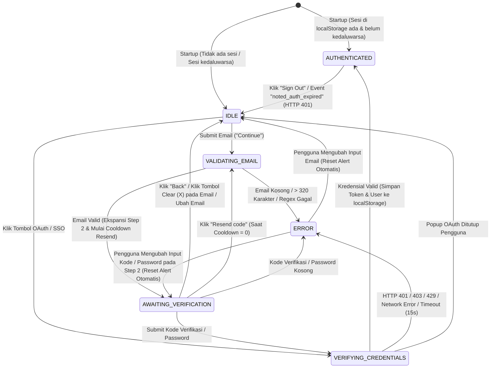

# Spesifikasi Perilaku Clean-Room: Autentikasi & Form Login (Noted)

**Versi Dokumen:** 1.0.0  
**Target Implementasi:** Aplikasi Web & Desktop **Noted** (React + Vite + Vanilla CSS)  
**Sifat Dokumen:** Spesifikasi Perilaku Murni (*Clean-Room Behavior-Only Specification*)

---

## 1. Ikhtisar & Prinsip Clean-Room

Dokumen ini mendefinisikan spesifikasi fungsional, kontrak model data, mesin status (*state machine*), penanganan kondisi batas (*edge cases*), penanganan kesalahan (*error handling*), kontrak antarmuka visual (UI/UX), serta daftar kasus uji (*test cases*) untuk modul **Autentikasi & Form Login** pada aplikasi **Noted**.

### Prinsip Kepatuhan Clean-Room
1. **Bebas Kode & Simbol Eksternal:** Dokumen ini disusun secara murni berdasarkan observasi perilaku fungsional dan spesifikasi antarmuka pengguna yang diharapkan. Tidak terdapat salinan kode sumber eksternal, nama berkas internal pihak ketiga, pengenal bundel, ataupun nama variabel internal dari aplikasi pihak ketiga.
2. **Implementasi Independen:** Pengembang (`rea-builder`) wajib mengimplementasikan seluruh logika komponen, pengelola sesi, validasi input, dan aturan gaya (CSS) secara mandiri menggunakan arsitektur **Noted** (React, Vite, dan Vanilla CSS).
3. **Aset & Identitas Mandiri:** Seluruh ikon vektor (SVG), teks antarmuka, dan penamaan kunci penyimpanan lokal menggunakan ruang nama (*namespace*) milik **Noted**.

---

## 2. Requirements Fungsional (`FR-01` s/d `FR-12`)

| ID | Nama Requirement | Deskripsi Perilaku Fungsional |
| :--- | :--- | :--- |
| **FR-01** | **Tampilan Awal Multi-Metode (`EMAIL_ENTRY`)** | Saat pengguna belum terautentikasi atau membuka dialog login/tambah akun, sistem menampilkan halaman atau modal login yang memuat: (1) blok judul & subjudul, (2) deretan tombol autentikasi pihak ketiga/SSO (*Continue with Google*, *Continue with Apple*, *Continue with Microsoft*, *Log in with passkey*, dan *Single sign-on (SSO)*), (3) pemisah horizontal bertuliskan `"OR"`, serta (4) form input alamat email beserta tombol aksi utama `"Continue"`. |
| **FR-02** | **Normalisasi & Validasi Alamat Email** | Sebelum melanjutkan dari langkah pertama (`EMAIL_ENTRY`), sistem wajib menormalisasi input email dengan menghapus spasi di awal/akhir dan mengubah seluruh karakter menjadi huruf kecil (`trim().toLowerCase()`). Alamat email dinyatakan valid apabila tidak kosong, panjang karakter setelah normalisasi `<= 320` karakter, dan memenuhi ekspresi reguler standar `^[^\s@]+@[^\s@]+\.[^\s@]+$`. |
| **FR-03** | **Tombol Hapus Cepat (*Clear Input Button*)** | Pada kolom input email dan kolom input kode verifikasi, apabila panjang nilai input lebih dari `0` karakter (`value.length > 0`) dan input tidak sedang dalam status *loading* atau *disabled*, sistem wajib menampilkan tombol ikon silang berbentuk lingkaran berukuran `16px x 16px` di sisi dalam sebelah kanan input. Menekan tombol ini akan mengosongkan nilai input, menghapus status error aktif, mengembalikan fokus ke elemen input tersebut, dan (jika berada pada langkah ke-2 untuk input email) mengembalikan form ke langkah pertama (`EMAIL_ENTRY`). |
| **FR-04** | **Ekspansi Langkah Kedua (`VERIFICATION_OR_PASSWORD`)** | Setelah alamat email yang valid dikirimkan pada langkah pertama, sistem melakukan transisi ke langkah kedua dengan mengekspansi kontainer langkah verifikasi secara mulus (`max-height` dan `opacity` dengan durasi `0.5s ease-in-out`). Pengguna dapat menyelesaikan autentikasi menggunakan **Kode Verifikasi (OTP 6 digit / kode login sekali pakai)** atau beralih ke mode **Kata Sandi (*Password*)** serta mengisi nama tampilan opsional bagi akun baru. |
| **FR-05** | **Pengiriman & Verifikasi Kode Login / Kredensial** | Pada langkah kedua (`VERIFICATION_OR_PASSWORD`), tombol submit utama berubah label menjadi `"Continue with login code"` (saat mode kode verifikasi aktif) atau `"Log in"` (saat mode kata sandi aktif). Ketika pengguna menekan tombol submit atau menekan tombol `Enter`, sistem memvalidasi bahwa kode verifikasi (6 karakter/digit) atau kata sandi tidak kosong, lalu memanggil layanan verifikasi kredensial. |
| **FR-06** | **Pengiriman Ulang Kode (*Resend Code*) dengan Cooldown Timer** | Pada mode verifikasi kode login, sistem menyediakan tombol aksi sekunder `"Resend code"`. Setelah kode dikirimkan atau dikirim ulang, tombol `"Resend code"` dinonaktifkan selama periode *cooldown* (default `30` detik) sambil menampilkan hitung mundur (mis. `"Resend code (30s)"`) untuk mencegah pengiriman beruntun yang berlebihan. |
| **FR-07** | **Navigasi Kembali / Ubah Email (`Back` / Edit Email)** | Saat berada di langkah kedua (`VERIFICATION_OR_PASSWORD`), pengguna dapat mengubah alamat email dengan menekan tombol `"Back"` / `"Change email"` atau dengan mengedit/menghapus isi kolom email. Aksi ini segera menyembunyikan kontainer langkah kedua, mengosongkan nilai kode verifikasi/kata sandi yang telah diketik, menghapus pesan error yang tampil, dan mengembalikan status form ke `IDLE` pada langkah `EMAIL_ENTRY`. |
| **FR-08** | **Autentikasi Pihak Ketiga (OAuth Popup & Handoff Desktop)** | Ketika pengguna menekan salah satu tombol SSO (seperti *Continue with Google*), sistem membuka alur autentikasi penyedia terkait (melalui *popup* terisolasi pada web atau *session handoff* melalui browser eksternal dengan skema protokol kustom `noted://auth` pada lingkungan desktop). Apabila jendela popup ditutup oleh pengguna sebelum selesai, status kembali ke `IDLE` tanpa merusak state form. |
| **FR-09** | **Penerbitan & Penyimpanan Sesi Lokal (`localStorage`)** | Setelah kredensial diverifikasi (baik melalui Email/Kode/Sandi maupun OAuth/SSO), sistem membuat objek `AuthSession` dan `AuthUser`, menyimpan token sesi ke `localStorage` pada kunci `noted_session_token_v1`, menyimpan profil pengguna aktif pada kunci `noted_current_user_v1`, memperbarui daftar multi-akun pada kunci `noted_saved_accounts_v1`, serta memancarkan *custom event* global `noted_auth_changed`. |
| **FR-10** | **Pemulihan Sesi Otomatis (*Auto-Restore Session* saat Startup)** | Saat aplikasi pertama kali dimuat (*startup*), sistem memeriksa keberadaan dan masa berlaku (`expiresAt`) token sesi di `localStorage` (`noted_session_token_v1`) serta data pengguna (`noted_current_user_v1`). Jika token ada dan belum kedaluwarsa (`Date.now() < expiresAt`), pengguna langsung masuk ke status `AUTHENTICATED` tanpa perlu melewati layar login. |
| **FR-11** | **Penanganan Sesi Kedaluwarsa Otomatis (`auth-expired` / HTTP 401)** | Apabila layanan API mengembalikan respons HTTP `401 Unauthorized` atau sistem menerima event global `noted_auth_expired` / `session-expired`, sistem secara otomatis menghapus token sesi aktif dari `localStorage`, mengubah status pengguna kembali menjadi tidak terautentikasi (atau mode tamu), dan menampilkan kembali antarmuka login dengan pesan informasi bahwa sesi telah berakhir. |
| **FR-12** | **Terminasi Sesi (*Sign Out* & *Multi-Account Switch*)** | Ketika pengguna menekan tombol `"Sign Out"` (atau `"Log out"`), sistem menghapus token sesi aktif (`noted_session_token_v1`), mereset pengguna aktif ke profil tamu default (`isLoggedIn: false`), mempertahankan identitas perangkat lokal bila diperlukan, memancarkan event `noted_auth_changed`, dan mengarahkan tampilan ke layar login atau memilih akun tersimpan berikutnya. |

---

## 3. Model Data & Kontrak State

### 3.1 Konstanta Konfigurasi Autentikasi

```typescript
export const AUTH_CONFIG = {
  EMAIL_MAX_LENGTH: 320,
  EMAIL_REGEX: /^[^\s@]+@[^\s@]+\.[^\s@]+$/,
  OTP_CODE_LENGTH: 6,
  PASSWORD_MIN_LENGTH: 6,
  REQUEST_TIMEOUT_MS: 15000,         // Batas waktu tunggu per permintaan form (15 detik)
  PAGE_WATCHDOG_TIMEOUT_MS: 90000,   // Batas waktu tunggu watchdog pemuatan halaman (90 detik)
  RESEND_COOLDOWN_SECONDS: 30,       // Waktu tunggu kirim ulang kode verifikasi (30 detik)
  SESSION_TTL_SECONDS: 2592000,      // Durasi sesi aktif: 30 hari (30 * 24 * 60 * 60)
  SESSION_TTL_MS: 2592000000,        // Durasi sesi aktif dalam milidetik
  STORAGE_KEYS: {
    SESSION_TOKEN: 'noted_session_token_v1',
    CURRENT_USER: 'noted_current_user_v1',
    SAVED_ACCOUNTS: 'noted_saved_accounts_v1',
    PENDING_VERIFICATION: 'noted_pending_verification_v1',
    DEVICE_ID: 'noted_device_id_v1',
  },
  EVENTS: {
    AUTH_CHANGED: 'noted_auth_changed',
    AUTH_EXPIRED: 'noted_auth_expired',
  },
} as const;
```

### 3.2 Struktur Objek `AuthUser`

Merepresentasikan profil pengguna yang sedang aktif di dalam aplikasi:

```typescript
export type AuthProviderType = 'email' | 'google' | 'apple' | 'microsoft' | 'passkey' | 'sso' | 'guest';

export interface AuthUser {
  id: string;                  // Pengenal unik pengguna (mis. UUID v4 atau "email_<hash>" / "google_<sub>")
  email: string;               // Alamat email yang telah dinormalisasi (huruf kecil, tanpa spasi tepi)
  name: string;                // Nama tampilan pengguna
  picture: string | null;      // URL foto profil (jika tersedia dari OAuth, atau null)
  avatar: string;              // Inisial 1-2 huruf untuk fallback avatar (mis. "DA")
  color: string;               // Warna aksen avatar dalam format Hex (mis. "#2383E2")
  isLoggedIn: boolean;         // Status apakah pengguna terautentikasi (true) atau mode tamu (false)
  loginProvider: AuthProviderType;
  loggedInAt: number | null;   // Timestamp Unix (ms) saat sesi dibuat
}
```

### 3.3 Struktur Objek `AuthSession`

Merepresentasikan kredensial sesi terautentikasi yang disimpan di sisi klien:

```typescript
export interface AuthSession {
  token: string;               // Token sesi bertanda tangan (format "<payloadBase64Url>.<signatureBase64Url>" atau token lokal)
  userId: string;              // Mengacu pada AuthUser.id
  email: string;               // Mengacu pada AuthUser.email
  provider: AuthProviderType;  // Metode login yang digunakan
  issuedAt: number;            // Timestamp Unix (ms) waktu penerbitan sesi
  expiresAt: number;           // Timestamp Unix (ms) waktu kedaluwarsa (issuedAt + SESSION_TTL_MS)
}
```

### 3.4 Struktur Objek `LoginFormPayload`

Kontrak payload input yang dikumpulkan dari komponen form login pada setiap tahapan:

```typescript
export type LoginStep = 'EMAIL_ENTRY' | 'VERIFICATION_OR_PASSWORD';
export type VerificationMethod = 'OTP_CODE' | 'PASSWORD';

export interface LoginFormPayload {
  step: LoginStep;
  email: string;                       // Input email mentah dari pengguna (dinormalisasi saat validasi)
  normalizedEmail: string;             // Hasil email.trim().toLowerCase()
  verificationMethod: VerificationMethod;
  verificationCode?: string;           // Kode OTP 6 karakter/digit (wajib jika verificationMethod === 'OTP_CODE' pada step 2)
  password?: string;                   // Kata sandi pengguna (wajib jika verificationMethod === 'PASSWORD' pada step 2)
  displayName?: string;                // Nama tampilan opsional untuk pendaftaran/akun baru
  redirectUrl?: string;                // URL tujuan opsional setelah autentikasi berhasil
  addAnotherAccount?: boolean;         // Flag apakah login dipicu dari menu tambah akun kedua
}
```

### 3.5 Struktur Objek `AuthError`

Kontrak standar untuk seluruh kesalahan validasi maupun kegagalan komunikasi autentikasi:

```typescript
export type AuthErrorCode =
  | 'EMPTY_EMAIL'
  | 'INVALID_EMAIL_FORMAT'
  | 'EMAIL_TOO_LONG'
  | 'EMPTY_VERIFICATION_CODE'
  | 'INVALID_VERIFICATION_CODE'
  | 'EMPTY_PASSWORD'
  | 'INVALID_CREDENTIALS'
  | 'UNVERIFIED_EMAIL'
  | 'ORIGIN_NOT_ALLOWED'
  | 'RATE_LIMITED'
  | 'NETWORK_ERROR'
  | 'TIMEOUT_ERROR'
  | 'SERVER_MISCONFIGURED'
  | 'OAUTH_POPUP_CLOSED'
  | 'PROTOCOL_NOT_REGISTERED'
  | 'SESSION_EXPIRED';

export interface AuthError {
  code: AuthErrorCode;
  message: string;             // Pesan yang ramah pengguna untuk ditampilkan pada elemen role="alert"
  httpStatus?: number;         // Kode status HTTP opsional (400, 401, 403, 429, 500, 503)
  field?: 'email' | 'verificationCode' | 'password' | 'general'; // Target input untuk penandaan focus ring merah
  retryAfterSeconds?: number;  // Waktu tunggu (detik) khusus untuk kode RATE_LIMITED (HTTP 429)
}
```

---

## 4. Alur Status Login (State Machine)

### 4.1 Definisi Status (*States*)

1. **`IDLE`**: Status awal saat form ditampilkan pada langkah `EMAIL_ENTRY`. Pengguna dapat mengetik email atau memilih tombol SSO. Tidak ada proses jaringan yang sedang berjalan (`isLoading = false`).
2. **`VALIDATING_EMAIL`**: Status transisi sinkron/asinkron saat pengguna menekan `"Continue"` pada langkah `EMAIL_ENTRY`. Sistem menormalisasi email (`trim().toLowerCase()`), memvalidasi panjang (`<= 320`) serta pola regex, dan menyiapkan pengiriman kode verifikasi atau pengecekan metode login.
3. **`AWAITING_VERIFICATION`**: Email dinyatakan valid. Kontainer langkah ke-2 (`VERIFICATION_OR_PASSWORD`) terbuka dengan transisi `0.5s ease-in-out`. Pengguna diminta memasukkan kode verifikasi 6 digit atau kata sandi. Timer *cooldown* `"Resend code"` berjalan.
4. **`VERIFYING_CREDENTIALS`**: Pengguna telah menekan `"Continue with login code"` / `"Log in"` atau menyelesaikan *callback* OAuth/SSO. Tombol submit dinonaktifkan (`disabled = true`, `opacity: 0.4`), menampilkan *loading spinner* berputar, dan mengabaikan klik submit ganda.
5. **`AUTHENTICATED`**: Verifikasi kredensial berhasil (`200 OK`). Sesi (`noted_session_token_v1`) dan profil pengguna (`noted_current_user_v1`) disimpan di `localStorage`, event `noted_auth_changed` dipancarkan, modal/halaman login ditutup, dan pengguna diarahkan ke ruang kerja utama (*Workspace*).
6. **`ERROR`**: Terjadi kegagalan validasi input atau kegagalan respons server (`400`, `401`, `403`, `429`, `500`, `503`, atau *timeout* `15000ms`). Elemen `<div role="alert" aria-live="polite">` menampilkan `AuthError.message` berwarna merah dan kolom input terkait menampilkan *focus ring* merah (`errorOutline`).

### 4.2 Diagram State Machine



### 4.3 Aturan Transisi & Reset Otomatis
- **Auto-Clear Alert saat Mengetik:** Ketika form berada pada status `ERROR`, setiap perubahan karakter (`onChange`) pada kolom email, kode verifikasi, atau kata sandi **wajib langsung menghapus objek `error` (`error = null`)** dan menghilangkan garis tepi merah pada input tanpa menunggu pengguna menekan tombol submit lagi.
- **Perubahan Email Mereset Langkah Kedua:** Jika pengguna sedang berada di `AWAITING_VERIFICATION` lalu mengubah teks pada input email atau menekan tombol *clear* (`X`) pada input email, form **wajib** menutup langkah ke-2 (`step = 'EMAIL_ENTRY'`), mengosongkan nilai `verificationCode` dan `password`, serta mengembalikan label tombol utama menjadi `"Continue"`.

---

## 5. Penanganan Edge Cases & Error Handling

Tabel berikut menetapkan perilaku sistem secara eksak untuk setiap kondisi batas (*edge case*) dan kesalahan runtime:

| No | Skenario / Kondisi Batas | Deteksi & Pemicu | Kode Error (`AuthErrorCode`) | Pesan UI (`role="alert"`) | Perilaku UI & Pemulihan |
| :--- | :--- | :--- | :--- | :--- | :--- |
| **1** | **Input Email Kosong atau Hanya Spasi** | Pengguna menekan `"Continue"` saat `email.trim().length === 0`. | `EMPTY_EMAIL` | `"Masukkan alamat email yang valid."` | Permintaan jaringan dibatalkan. Kolom email diberi fokus dan menampilkan `inputRedFocusRing`. |
| **2** | **Format Email Tidak Valid** | `email.trim().toLowerCase()` tidak cocok dengan `/^[^\s@]+@[^\s@]+\.[^\s@]+$/` (mis. tanpa `@`, tanpa domain/TLD, atau mengandung spasi di tengah). | `INVALID_EMAIL_FORMAT` | `"Masukkan alamat email yang valid."` | Permintaan jaringan dibatalkan. Kolom email ditandai `aria-invalid="true"` dengan `inputRedFocusRing`. |
| **3** | **Panjang Email Melebihi 320 Karakter** | `email.trim().length > 320`. | `EMAIL_TOO_LONG` | `"Alamat email tidak boleh melebihi 320 karakter."` | Permintaan jaringan dibatalkan. Kolom email ditandai `aria-invalid="true"` dengan `inputRedFocusRing`. |
| **4** | **Kode Verifikasi / Password Kosong pada Step 2** | Pengguna menekan submit pada langkah ke-2 saat kode verifikasi kosong/kurang dari 6 karakter (mode OTP) atau password kosong (mode Password). | `EMPTY_VERIFICATION_CODE` / `EMPTY_PASSWORD` | `"Masukkan kode verifikasi 6 digit."` atau `"Masukkan kata sandi Anda."` | Permintaan jaringan dibatalkan. Fokus diarahkan ke kolom kode verifikasi atau kata sandi dengan `inputRedFocusRing`. |
| **5** | **Kode Verifikasi atau Kredensial Salah (HTTP 401)** | Server atau validator lokal menolak kode OTP, kata sandi, atau token OAuth dengan status `401`. | `INVALID_CREDENTIALS` | `"Kode verifikasi atau kata sandi tidak valid. Silakan periksa kembali."` (atau pesan spesifik OAuth) | Status kembali dari `VERIFYING_CREDENTIALS` ke `ERROR` (tetap di Step 2 untuk OTP/Password). Tombol submit kembali aktif; nilai input tidak dihapus agar bisa dikoreksi. |
| **6** | **Batas Percobaan Terlampaui / Rate Limit (HTTP 429)** | Pengguna mengirim permintaan kode atau verifikasi melebihi batas frekuensi (respons HTTP `429` atau *rate limiter* lokal). | `RATE_LIMITED` | `"Terlalu banyak percobaan login. Silakan tunggu beberapa saat sebelum mencoba lagi."` | Tombol submit dan `"Resend code"` dinonaktifkan selama durasi `retryAfterSeconds` (default `30` detik). |
| **7** | **Koneksi Gagal / Offline (`NETWORK_ERROR`)** | `navigator.onLine === false` atau `fetch` melempar `TypeError` (gagal terhubung ke jaringan). | `NETWORK_ERROR` | `"Gagal terhubung ke server. Periksa koneksi internet Anda dan coba lagi."` | Untuk login OAuth yang membutuhkan server, tampilkan alert error. Untuk mode ruang kerja lokal/offline jika diizinkan, sediakan opsi melanjutkan secara lokal tanpa kehilangan data. |
| **8** | **Waktu Permintaan Habis (`TIMEOUT_ERROR`)** | Permintaan autentikasi tidak mendapat respons dalam `15000ms` (`AUTH_CONFIG.REQUEST_TIMEOUT_MS`). | `TIMEOUT_ERROR` | `"Waktu permintaan habis (timeout). Silakan coba lagi."` | `AbortController` membatalkan request yang menggantung, mematikan indikator *loading*, mengaktifkan kembali tombol submit, dan menampilkan pesan error. |
| **9** | **Submit Ganda saat Loading (*Double-Submit Deduplication*)** | Pengguna menekan tombol `"Continue"` / `"Log in"` atau menekan `Enter` berkali-kali saat `status === 'VALIDATING_EMAIL'` atau `'VERIFYING_CREDENTIALS'`. | *(Tidak menghasilkan error)* | *(Tidak ada pesan error)* | Handler `onSubmit` wajib memeriksa guard `if (isLoading) return;` di baris pertama, dan elemen `<button type="submit">` wajib memiliki atribut `disabled={isLoading}` serta `pointer-events: none`. Hanya 1 permintaan yang dieksekusi. |
| **10** | **Sesi Kedaluwarsa Saat Aplikasi Berjalan (`SESSION_EXPIRED`)** | Token sesi melewati `expiresAt` (> 30 hari) atau API mengembalikan `401` di tengah penggunaan aplikasi. | `SESSION_EXPIRED` | `"Sesi Anda telah berakhir. Silakan masuk kembali."` | Token dihapus dari `localStorage`, state aplikasi kembali ke tidak terautentikasi, dan form login ditampilkan dengan pesan pemberitahuan. |

---

## 6. Spesifikasi Visual & Token Desain (UI/UX Contract)

Bagian ini mendefinisikan kontrak tampilan dan aturan CSS eksak untuk halaman penuh (*Full-Page Login*) maupun dialog modal (*Login Modal*) dalam **Light Mode** dan **Dark Mode**.

### 6.1 Struktur Layout & Dimensi Kontainer

1. **Root Halaman Login (`.noted-login-page`)**:
   - `min-height: 100vh; width: 100%; display: flex; flex-direction: column; overflow: auto;`
   - `background-color: var(--login-bg-primary); color: var(--login-text-primary);`
2. **Top Header Bar (`.noted-login-topbar`)**:
   - `width: 100%; height: 45px; flex-shrink: 0; display: flex; align-items: center; padding: 0 16px;`
   - Pada lingkungan desktop mendukung `-webkit-app-region: drag;` dengan elemen interaktif di dalamnya memiliki `-webkit-app-region: no-drag;`.
   - Memuat logo aplikasi berukuran `30px x 30px` (atau `32px x 32px` pada layar `> 1020px`) dengan jarak `10px` ke teks nama aplikasi (`font-size: 16px; font-weight: 500;`).
3. **Wrapper Tengah Utama (`.noted-login-main`)**:
   - `flex-grow: 1; display: flex; flex-direction: column; align-items: center; justify-content: center; width: 100%; padding-top: 45px; padding-bottom: 60px; user-select: none;`
4. **Kontainer Form Inti (`.noted-login-container`)**:
   - `width: 100%; max-width: 360px;` (untuk halaman login penuh) atau `max-width: 320px;` (ketika dirender di dalam dialog modal berukuran `width: 480px; border-radius: 12px;`).
   - `display: flex; flex-direction: column; align-items: center;`
5. **Fixed Bottom Footer Bar (`.noted-login-footer`)**:
   - `position: fixed; bottom: 0; inset-inline: 0; padding-bottom: 16px; display: flex; flex-direction: column; align-items: center; justify-content: center; gap: 4px; font-size: 12px; line-height: 1.2; background-color: var(--login-bg-primary); color: var(--login-text-secondary);`

### 6.2 Tabel Nilai CSS Eksak (Light Mode & Dark Mode)

| Kategori / Token | Properti / Variabel CSS | Nilai Eksak Light Mode | Nilai Eksak Dark Mode | Komponen Pengguna |
| :--- | :--- | :--- | :--- | :--- |
| **Background Primer** | `--login-bg-primary` | `#FFFFFF` (`rgba(255, 255, 255, 1)`) | `#191919` (`rgba(25, 25, 25, 1)`) | Latar halaman utama & footer bawah |
| **Background Sekunder** | `--login-bg-secondary` | `#F9F8F7` (`rgba(249, 248, 247, 1)`) | `#202020` (`rgba(32, 32, 32, 1)`) | Latar kartu modal (`elevated`) & banner info |
| **Background Input Klasik** | `--login-bg-input` | `rgba(242, 241, 238, 0.6)` (atau `transparent` pada varian modern) | `rgba(255, 255, 255, 0.055)` (atau `transparent` pada varian modern) | Latar kolom `<input>` email, kode, dan sandi |
| **Teks Primer** | `--login-text-primary` | `#2C2C2B` (`rgba(44, 44, 43, 1)`) | `#F0EFED` (`rgba(240, 239, 237, 1)`) | Judul utama, nilai teks input, teks tombol SSO |
| **Teks Sekunder** | `--login-text-secondary` | `#7D7A75` (`rgba(125, 122, 117, 1)`) | `#ADA9A3` (`rgba(173, 169, 163, 1)`) | Subjudul, label input (`12px`), caption, disclaimer, footer |
| **Teks Tertier / Placeholder** | `--login-text-tertiary` | `#A19E99` (`rgba(161, 158, 153, 1)`) | `#7D7A75` (`rgba(125, 122, 117, 1)`) | Placeholder input, label pemisah `"OR"`, ikon clear (`X`) |
| **Teks Disabled** | `--login-text-disabled` | `#BCBAB6` (`rgba(188, 186, 182, 1)`) | `#5F5E59` (`rgba(95, 94, 89, 1)`) | Teks pada elemen input/tombol yang dinonaktifkan |
| **Warna Pesan Error** | `--login-text-error` | `#CD3C3A` (`rgba(205, 60, 58, 1)`) | `#DF5452` (`rgba(223, 84, 82, 1)`) | Pesan error validasi & autentikasi (`role="alert"`) |
| **Garis Divider (`OR`)** | `--login-border-divider` | `#E6E5E3` (`rgba(230, 229, 227, 1)`) | `#383836` (`rgba(56, 56, 54, 1)`) | Garis horizontal `1px` di kiri & kanan teks `"OR"` |
| **Outline Input Default** | `--login-input-shadow` | `0px 2px 4px 0px rgba(0, 0, 0, 0.039), 0px 0px 0px 1px rgba(42, 28, 0, 0.07)` (atau `rgba(28, 19, 1, 0.11) 0px 0px 0px 1px`) | `0px 0px 0px 1px rgba(56, 56, 54, 1), 0px 2px 4px 0px rgba(25, 25, 25, 0.079)` (atau `rgba(255, 255, 235, 0.1) 0px 0px 0px 1px`) | `box-shadow` default pada `<input>` |
| **Focus Ring Input (Biru)** | `--login-input-focus-ring` | `rgba(35, 131, 226, 0.57) 0px 0px 0px 1px inset, rgba(35, 131, 226, 0.35) 0px 0px 0px 2px` | `rgba(35, 131, 226, 0.57) 0px 0px 0px 1px inset, rgba(35, 131, 226, 0.35) 0px 0px 0px 2px` | `box-shadow` saat `<input>` aktif (`:focus` / `:focus-within`) |
| **Focus Ring Error (Merah)** | `--login-input-error-ring` | `0px 0px 0px 1px rgba(205, 60, 58, 1) inset, 0px 0px 0px 1px rgba(205, 60, 58, 1)` | `0px 0px 0px 1px rgba(205, 60, 58, 1) inset, 0px 0px 0px 1px rgba(205, 60, 58, 1)` | `box-shadow` saat `<input>` memiliki status error |
| **Tombol Submit Utama** | `--login-btn-primary-bg` | Default: `#2383E2`<br>Hover: `#0077D4`<br>Active: `#006BC7`<br>Text: `#FFFFFF`<br>Disabled: `opacity: 0.4` | Default: `#2383E2`<br>Hover: `#0077D4`<br>Active: `#006BC7`<br>Text: `#FFFFFF`<br>Disabled: `opacity: 0.4` | Tombol `"Continue"`, `"Continue with login code"`, `"Log in"` |
| **Tombol SSO / Sekunder** | `--login-btn-sso` | Bg: `#FFFFFF`<br>Border: `1px solid rgba(55, 53, 47, 0.16)`<br>Hover Bg: `rgba(55, 53, 47, 0.06)`<br>Active Bg: `rgba(55, 53, 47, 0.16)` | Bg: `rgba(255, 255, 255, 0.055)`<br>Border: `1px solid rgba(255, 255, 255, 0.13)`<br>Hover Bg: `rgba(255, 255, 255, 0.055)`<br>Active Bg: `rgba(255, 255, 255, 0.03)` | Tombol Google, Apple, Microsoft, Passkey, SSO |
| **Bayangan Modal** | `--login-modal-shadow` | `0px 20px 24px 0px rgba(25, 25, 25, 0.059), 0px 5px 9px 0px rgba(25, 25, 25, 0.029), 0px 0px 0px 1px rgba(42, 28, 0, 0.07)` | `0px 0px 0px 1px rgba(56, 56, 54, 1), 0px 20px 24px 0px rgba(15, 15, 15, 0.35), 0px 5px 9px 0px rgba(15, 15, 15, 0.2)` | Kontainer kartu dialog modal login |

### 6.3 Spesifikasi Komponen UI Detail

1. **Tipografi**:
   - Font Stack UI: `-apple-system, BlinkMacSystemFont, "Segoe UI", Helvetica, "Apple Color Emoji", Arial, sans-serif, "Segoe UI Emoji", "Segoe UI Symbol"`.
   - Font Stack Monospace (khusus input kode OTP): `"iawriter-mono", Nitti, Menlo, Courier, monospace`.
   - Heading Utama: `font-size: 22px` (atau `24px`), `font-weight: 600`, `line-height: 1.2`, `letter-spacing: -0.02em`, `color: var(--login-text-primary)`.
   - Subjudul: `font-size: 22px` (`font-weight: 600`) atau `15px` (`font-weight: 400` pada modal), `color: var(--login-text-secondary)`, `margin-bottom: 24px`.
   - Label Input (`Email`, `Verification code`, `Password`): `font-size: 12px`, `font-weight: 500`, `line-height: 16px`, `color: var(--login-text-secondary)`, `margin-bottom: 4px`.

2. **Kolom Input (`Email`, `Verification Code`, `Password`)**:
   - Tinggi: `36px` (mode klasik/modal, `border-radius: 6px`, `padding: 4px 10px`, `font-size: 15px`) atau `40px` (mode halaman penuh, `border-radius: 8px`, `padding: 10px 16px`, `font-size: 14px`).
   - Lebar: `width: 100%; box-sizing: border-box;`.
   - Ketika `value.length > 0`, tampilkan tombol *clear* (`<button type="button" aria-label="Clear input">`) di sisi kanan dalam input dengan ikon silang lingkaran berdiameter `16px x 16px`, warna `var(--login-text-tertiary)`, `border-radius: 20px`, dan efek hover `background-color: rgba(33, 27, 23, 0.05)`.

3. **Kontainer Ekspansi Step Kedua (`.noted-animated-step`)**:
   - State tertutup (`step === 'EMAIL_ENTRY'`): `max-height: 0; opacity: 0; overflow: hidden; pointer-events: none;`.
   - State terbuka (`step === 'VERIFICATION_OR_PASSWORD'`): `max-height: 5000px; opacity: 1; overflow: visible; pointer-events: auto;`.
   - Properti transisi wajib: `transition: all 0.5s ease-in-out;`.

4. **Tombol Submit Utama (`.noted-submit-btn`)**:
   - Dimensi: `width: 100%; height: 36px` (atau `40px`), `border-radius: 6px` (atau `8px`), `margin-top: 6px; padding-inline: 12px;`.
   - Tipografi: `font-size: 14px; font-weight: 500; line-height: 1; color: #FFFFFF;`.
   - Transisi: `transition: background-color 150ms ease, color 150ms ease;`.
   - Focus visible: `box-shadow: 0px 0px 0px 2px #F8F8F7, 0px 0px 0px 4px #2383E2, 0px 0px 0px 6px rgba(255, 255, 255, 0.25)` (Light) / `0px 0px 0px 2px #191919, 0px 0px 0px 4px #2383E2, 0px 0px 0px 6px #191919` (Dark).

5. **Tombol SSO (`.noted-sso-btn`)**:
   - Dimensi: `width: 100%; height: 36px; border-radius: 6px; padding-inline: 12px; display: flex; align-items: center; justify-content: center; position: relative;`.
   - Jarak antar tombol SSO: `gap: 8px`.
   - Ikon berukuran `18px x 18px` (atau `20px x 20px`), ditempatkan di sisi kiri (`position: absolute; inset-inline-start: 12px;` atau `margin-right: 8px`).
   - Transisi hover: `transition: background 20ms ease-in 0s;`.

6. **Komponen Pesan Error (`role="alert"`)**:
   - Wajib memiliki atribut aksesibilitas: `role="alert" aria-live="polite" aria-atomic="true"`.
   - Gaya visual: `font-size: 14px; font-weight: 400; line-height: 1.4; color: var(--login-text-error); text-align: center; width: 100%; margin: 12px 0; background: transparent; border: none;`.

7. **Loading Spinner (`.noted-spinner`)**:
   - Di dalam tombol submit: ukuran `16px x 16px`, `margin-inline-end: 6px`.
   - Pada pemuatan halaman awal: ukuran `22px x 22px`.
   - Lingkaran dasar: `border: 2px solid rgba(28, 19, 1, 0.11)` (Light) / `rgba(255, 255, 235, 0.1)` (Dark), `border-radius: 50%`.
   - Busur putar (*arc*): `border-top: 2px solid currentColor; border-right: 2px solid currentColor; border-bottom: 2px solid transparent; border-left: 2px solid transparent; border-radius: 50%; animation: noted-spinner-rotate 1.2s linear infinite;`.

---

## 7. Daftar Test Cases Konkret (`TC-01` s/d `TC-15`)

Seluruh kasus uji di bawah ini wajib diimplementasikan dalam pengujian otomatis dan diverifikasi oleh `rea-builder`:

| ID | Nama Test Case | Prekondisi / Input | Langkah Aksi | Output / Ekspektasi |
| :--- | :--- | :--- | :--- | :--- |
| **TC-01** | **Render Awal Form Login (`EMAIL_ENTRY`)** | Pengguna belum login (`localStorage` kosong). Komponen Login dirender. | 1. Muat komponen Login.<br>2. Periksa elemen yang tampil di DOM. | - Status awal adalah `IDLE` pada langkah `EMAIL_ENTRY`.<br>- Tombol SSO (Google, Apple, Passkey/SSO) tampil.<br>- Divider `"OR"` tampil.<br>- Input email tampil dan kosong.<br>- Kontainer langkah ke-2 (`VERIFICATION_OR_PASSWORD`) tersembunyi (`max-height: 0` / `opacity: 0` atau tidak aktif).<br>- Tombol submit menampilkan teks `"Continue"`. |
| **TC-02** | **Penolakan Email Kosong atau Hanya Spasi** | Form berada pada langkah `EMAIL_ENTRY`. Input email diisi `"   "` (hanya spasi) atau dibiarkan kosong `""`. | 1. Ketik `"   "` pada input email.<br>2. Klik tombol `"Continue"`. | - Form tidak berpindah ke langkah ke-2.<br>- Muncul elemen `<div role="alert" aria-live="polite">` dengan pesan `"Masukkan alamat email yang valid."`.<br>- Input email memiliki indikasi error (`aria-invalid="true"` / class error outline merah). |
| **TC-03** | **Penolakan Format Email Tidak Valid** | Form berada pada langkah `EMAIL_ENTRY`. Input email diisi `"user@domain"` (tanpa TLD) atau `"userdomain.com"` (tanpa `@`). | 1. Masukkan `"user@domain"` ke kolom email.<br>2. Klik tombol `"Continue"`. | - Transisi ke langkah ke-2 ditolak.<br>- Elemen `role="alert"` menampilkan `"Masukkan alamat email yang valid."`.<br>- Tidak ada panggilan pengiriman kode verifikasi. |
| **TC-04** | **Penolakan Email Melebihi 320 Karakter** | Form berada pada langkah `EMAIL_ENTRY`. Input email diisi string sepanjang `321` karakter (`"a".repeat(310) + "@example.com"`). | 1. Masukkan email 321 karakter.<br>2. Klik tombol `"Continue"`. | - Validasi menolak input dengan kode `EMAIL_TOO_LONG`.<br>- Elemen `role="alert"` menampilkan pesan bahwa alamat email tidak boleh melebihi 320 karakter.<br>- Form tetap pada langkah `EMAIL_ENTRY`. |
| **TC-05** | **Normalisasi Email (`trim` & `toLowerCase`) dan Transisi ke Step 2** | Form berada pada langkah `EMAIL_ENTRY`. Input email diisi `"  User.Name@Example.COM  "`. | 1. Ketik `"  User.Name@Example.COM  "` pada kolom email.<br>2. Klik tombol `"Continue"`. | - Email dinormalisasi menjadi `"user.name@example.com"`.<br>- Status beralih ke `AWAITING_VERIFICATION` (langkah `VERIFICATION_OR_PASSWORD`).<br>- Kontainer langkah ke-2 terbuka (`opacity: 1`).<br>- Input kode verifikasi / password tampil dan tombol submit berubah menjadi `"Continue with login code"` atau `"Log in"`. |
| **TC-06** | **Fungsi Tombol Clear Input (`X`) & Reset Alert Otomatis** | Form berada pada status `ERROR` dengan input email berisi `"salah@"`. | 1. Perhatikan tombol clear (`16px` circle) di ujung kanan input email.<br>2. Klik tombol clear (`X`) tersebut. | - Nilai input email menjadi kosong `""`.<br>- Elemen pesan error `role="alert"` langsung hilang dari DOM.<br>- Tombol clear (`X`) ikut tersembunyi karena `value.length === 0`.<br>- Fokus kembali ke kolom input email. |
| **TC-07** | **Navigasi Kembali ke Step 1 Saat Email Diubah atau Tombol Back Ditekan** | Form sudah berada pada langkah ke-2 (`VERIFICATION_OR_PASSWORD`) untuk `"user@example.com"`, dan pengguna sudah mengetik sebagian kode `"123"`. | 1. Klik tombol `"Back"` (atau klik tombol Clear `X` pada kolom email). | - Kontainer langkah ke-2 tertutup kembali ke `EMAIL_ENTRY`.<br>- Nilai kode verifikasi `"123"` dikosongkan.<br>- Tombol submit utama kembali menampilkan `"Continue"`. |
| **TC-08** | **Verifikasi Kode OTP / Password Berhasil & Penyimpanan Sesi** | Form berada pada langkah ke-2 (`VERIFICATION_OR_PASSWORD`) untuk `"rina@example.com"`. Kode verifikasi yang benar dimasukkan (mis. `"123456"` atau password valid). | 1. Masukkan kode verifikasi 6 digit yang valid.<br>2. Klik `"Continue with login code"` / `"Log in"`. | - Status beralih ke `VERIFYING_CREDENTIALS` lalu `AUTHENTICATED`.<br>- `localStorage.getItem('noted_session_token_v1')` berisi token sesi yang valid.<br>- `localStorage.getItem('noted_current_user_v1')` berisi JSON `AuthUser` dengan `email: "rina@example.com"` dan `isLoggedIn: true`.<br>- Event `noted_auth_changed` dipancarkan. |
| **TC-09** | **Penanganan Kode Verifikasi / Kredensial Salah (HTTP 401)** | Form berada pada langkah ke-2 (`VERIFICATION_OR_PASSWORD`). Layanan verifikasi dikonfigurasi menolak kode `"000000"` dengan error `401` (`INVALID_CREDENTIALS`). | 1. Masukkan kode `"000000"`.<br>2. Klik tombol submit. | - Status beralih ke `ERROR` namun tetap berada pada langkah ke-2.<br>- Elemen `role="alert"` menampilkan pesan kesalahan kredensial.<br>- Input kode verifikasi menampilkan `inputRedFocusRing`.<br>- `noted_session_token_v1` tidak disimpan ke `localStorage`. |
| **TC-10** | **Cooldown Timer pada Tombol `"Resend code"`** | Form baru saja masuk ke langkah ke-2 (`AWAITING_VERIFICATION`). | 1. Periksa status tombol `"Resend code"`.<br>2. Majukan waktu (*fake timers*) sebanyak 30 detik.<br>3. Klik `"Resend code"`. | - Saat awal masuk Step 2, tombol `"Resend code"` berstatus `disabled` dan menampilkan hitung mundur (mis. `30s`).<br>- Setelah 30 detik berlalu, tombol menjadi aktif (`disabled = false`).<br>- Saat diklik, kode dikirim ulang dan timer cooldown 30 detik dimulai kembali. |
| **TC-11** | **Penanganan Rate Limit (HTTP 429)** | Layanan autentikasi mengembalikan respons HTTP `429 Too Many Requests` (`RATE_LIMITED`). | 1. Submit form saat kondisi rate limit aktif. | - Elemen `role="alert"` menampilkan pesan `"Terlalu banyak percobaan login. Silakan tunggu beberapa saat sebelum mencoba lagi."`.<br>- Tombol submit dinonaktifkan sementara sesuai periode cooldown. |
| **TC-12** | **Penanganan Kondisi Offline / Network Error & Timeout (`15000ms`)** | Permintaan jaringan diatur gagal (`NetworkError`) atau menggantung lebih dari `15000ms`. | 1. Submit kredensial pada form.<br>2. Tunggu atau majukan timer melewati `15000ms`. | - Permintaan yang menggantung dibatalkan setelah `15000ms`.<br>- Indikator *loading spinner* berhenti dan tombol submit kembali aktif.<br>- Elemen `role="alert"` menampilkan pesan error jaringan atau timeout yang jelas. |
| **TC-13** | **Deduplikasi Submit Ganda (*Double-Submit Guard*)** | Permintaan verifikasi membutuhkan waktu 500ms untuk selesai. | 1. Masukkan data valid.<br>2. Klik tombol submit 3 kali berturut-turut secara cepat sebelum 500ms selesai. | - Selama permintaan pertama berjalan, tombol submit memiliki atribut `disabled` (`opacity: 0.4`) dan menampilkan `.noted-spinner`.<br>- Fungsi layanan autentikasi hanya dipanggil tepat **1 kali**. |
| **TC-14** | **Pemulihan Sesi Otomatis (*Auto-Restore*) & Penanganan Sesi Kedaluwarsa (`auth-expired`)** | `localStorage` memiliki `noted_session_token_v1` dan `noted_current_user_v1` yang masih berlaku (`expiresAt > Date.now()`). | 1. Inisialisasi aplikasi / panggil pemeriksa sesi.<br>2. Pancarkan event `window.dispatchEvent(new CustomEvent('noted_auth_expired'))` (atau simulasikan respons `401`). | - Pada langkah 1, sesi pengguna langsung pulih sebagai `AUTHENTICATED` tanpa perlu login ulang.<br>- Pada langkah 2, saat `noted_auth_expired` diterima, token di `localStorage` dihapus dan status pengguna kembali ke tidak terautentikasi. |
| **TC-15** | **Fungsi Sign Out (Logout) Bersih** | Pengguna sedang dalam status `AUTHENTICATED` (`noted_session_token_v1` dan `noted_current_user_v1` tersimpan di `localStorage`). | 1. Panggil aksi `logout()` / klik tombol `"Sign Out"`. | - Kunci `noted_session_token_v1` terhapus dari `localStorage`.<br>- Data `noted_current_user_v1` direset menjadi pengguna tamu (`isLoggedIn: false, loginProvider: 'guest'`).<br>- Event `noted_auth_changed` dipancarkan dan UI kembali menampilkan opsi login. |
